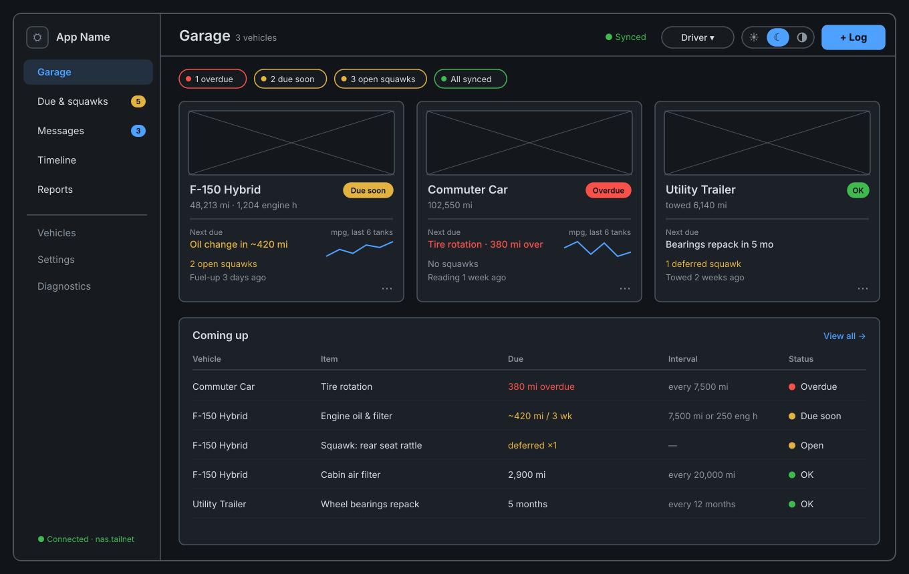
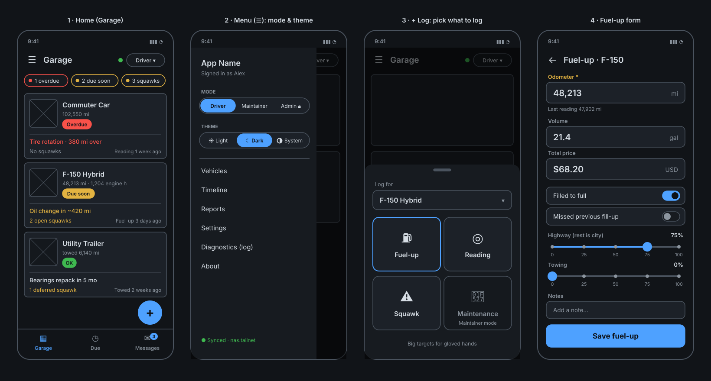

# Vehicle Maintenance Manager — Plan

*Working draft · last updated October 17, 2026*

A self-hosted app for tracking vehicles, everything that happens to them, and the maintenance that's coming due. It works offline and syncs to a master database on a NAS.

*Ideas raised but not yet decided are tracked separately in `docs/ideas-to-discuss.md`; they are not part of this plan until moved here.*

**Long-term aspiration (well past MVP):** extend the app, or a sibling app built on the same core, to **aircraft maintenance records**, alongside or instead of ground vehicles. Aircraft features are not being planned yet, but early data-model decisions are made so they won't block it (see Aircraft-ready groundwork).

---

## 1. Goals & Scope

- **Self-hosted, personal scale.** Built for the owner's own vehicles (or whoever self-hosts it).
  - A few vehicles, a couple of users, a few devices.
  - No multi-tenancy and no designing for scale that will never be needed.
- **Offline-first.** Maintenance often happens in a garage or out of cell coverage, so logging must work with no connection.
- **Cross-platform.** One codebase targeting:
  - Mobile: iOS, Android
  - Desktop: Windows, macOS, Linux
  - Possibly a web app as well
- **Docker-deployed server.** The NAS side (backend, web UI, and master database) ships as a Docker container, so it's easy to install, update, and move to other self-hosting setups.
- **Portable host.** A NAS is the primary target, but nothing may assume one: any always-on machine on the tailnet can host the server, or a single device can run **standalone with no server at all** (see Hosting options).

---

## 2. Technology Choices

| Area | Choice | Notes |
|---|---|---|
| Language | Rust (2024 edition) | Bump `edition` in `Cargo.toml` from the scaffolded `2021`; `cargo fix --edition` handles any migration. |
| UI framework | **Dioxus** | React-like components written in Rust; targets mobile, desktop, and web. Pre-1.0, so expect some API churn between releases. |
| Local database | SQLite (per device) | Embedded, works on desktop and mobile. |
| Master database | **SQLite** on the NAS | Same engine as the devices: one migration set and shared SQL. WAL mode, `STRICT` tables, file on a local volume. See section 6. |
| Backend service | **Dioxus fullstack** (built on Axum) | Runs on the NAS, owns the master DB, exposes the sync API via server functions, and serves the web UI. Shares data types with the clients. |
| Units of measure | **`uom` crate** | Type-safe physical quantities (distance, volume, time) in the app's domain types. See section 4. |
| Remote access | **Tailscale** | The only path to the server, including from inside the home network. |
| Deployment | **Docker** (docker-compose) on the NAS | App container with the SQLite database on a persistent volume. See section 7. |
| License | **MIT OR Apache-2.0** (dual) | The Rust ecosystem standard; users may choose either. `LICENSE-MIT` and `LICENSE-APACHE` files in the repo root. |
| Agent instructions | **`AGENTS.md`** | Read by multiple agent tools; strict workspace lints enforce the rules. See section 8. |

**Alternatives considered:** egui (weak on mobile), Iced (no real mobile support yet), Slint (strong cross-platform but uses its own markup language), Tauri (web-tech UI with a Rust backend).

---

## 3. Architecture

```
  ┌──────────────┐   ┌──────────────┐   ┌──────────────┐
  │ Phone app    │   │ Desktop app  │   │ Web app (opt)│
  │ (Dioxus)     │   │ (Dioxus)     │   │ (Dioxus)     │
  │ local SQLite │   │ local SQLite │   │              │  # web app may talk to server directly
  └──────┬───────┘   └──────┬───────┘   └──────┬───────┘
         │  sync when online│                  │
         └──────────────────┼──────────────────┘
                            ▼
        ┌───────── NAS: Docker (compose) ─────────┐
        │       ┌───────────────────────┐         │
        │       │ App container         │         │  # Dioxus fullstack: sync API + web UI
        │       │ (Dioxus fullstack)    │         │  # only process that opens the database
        │       └───────────┬───────────┘         │
        │                   ▼  local volume       │
        │       ┌───────────────────────┐         │
        │       │ Master DB (SQLite)    │         │  # single source of truth
        │       └───────────────────────┘         │
        └─────────────────────────────────────────┘
                 ▲ reachable only via Tailscale
```

### Local-first with sync

- Each device keeps a **full local copy** of the data.
- The app always **reads and writes locally**, so it's instant whether online or offline.
- When the device is back on the network, it **syncs** with the master database through the backend API: it pushes a log of commands and pulls changed records (see Sync protocol).
- Clients never touch the master database directly. This keeps one source of truth and keeps database credentials off devices.

### Sync & conflict handling

- **Device-generated unique IDs** (e.g. UUIDs) for every record, so devices can't create colliding records while offline.
- **Conflicts are expected to be rare:**
  - Realistically only one person works on a given vehicle at a time.
  - Logging is mostly **append-only**, and new records from different devices simply merge.
- **Edge case:** the same existing record edited on two devices before syncing. **Last-write-wins per record, ordered by hybrid logical clock (HLC)** is the rule. This applies to drafts and configuration; **finalized events are immutable** and are corrected by amendments, which are new records.

### Hybrid logical clocks (HLC)

Device wall clocks can drift or be set wrong, so plain wall-clock timestamps could let an older edit beat a newer one. Every change is stamped with an HLC instead, and the highest HLC wins.

- **Structure:** physical time (ms) + a logical counter + device ID as a final tiebreak. The ordering is total and deterministic.
- **Local edit:** use the later of the last HLC time and the wall clock. If the clock hasn't advanced (or is behind), bump the counter instead, so time never goes backward.
- **On sync:** when receiving changes, advance to the max of the local HLC, the incoming HLC, and the wall clock. Edits made after syncing always sort after everything received.
- **Effect:** a device with a slow clock still orders its edits correctly once it has synced.
- **Storage:** packs into one `u64` (48 bits of ms + 16 bits of counter) that sorts as a plain integer column. Each device persists its last HLC across restarts.
- **Guardrail:** the server rejects changes stamped more than a few minutes ahead of its own clock and flags that device. A clock set far in the future is HLC's one weakness.
- Start simple; don't build heavy conflict-resolution machinery until it's needed.

### Sync protocol: push commands, pull state

Devices don't send database rows or SQL. They send a log of **typed domain commands**.

**Why not raw SQL or SQLite sessions:**
- Client-sent SQL must never run on the server: any device token holder could run arbitrary SQL against the master database.
- SQLite session changesets apply only to SQLite and tie sync to the exact table layout.

**Commands**
- Defined as a Rust enum in the `domain` crate and serialized with serde. One variant per kind of change: create/update/delete event, add reading, skip reading, etc.
- Each command carries:
  - A **unique command ID**
  - The **device ID**
  - An **HLC stamp**
  - A **command format version**
  - The operation itself
- Every change on a device is written to the local database *and* appended to a local **outbox**.

**Push (device → server)**
- The device sends its outbox, in order.
- **Idempotent:** the server records applied command IDs, so retries after a dropped connection never apply anything twice.
- **Absolute values, never deltas** ("set reading to 123,456," not "add 100"), so replay or reordering can't corrupt data.
- Applied in **HLC order** with **last-write-wins per record**; a command older than the stored record's HLC is ignored.
- **Server re-validates** every command with the same shared-crate rules (monotonic readings, required meters, etc.).
- **Rejection path:** commands valid on the device but invalid on the server (e.g. another device synced a conflicting reading) are returned with a reason and shown to the user to resolve. Never dropped silently.
- The outbox is **pruned** once the server acknowledges each command.

**Pull (server → device)**
- The server assigns a **sequence number** to every accepted change.
- Each device keeps a **cursor** and pulls **current state of records changed since its cursor**, rather than replaying commands.
- Simple, and a device can always catch up, even after a long time offline.

**Deletes** become **tombstones** on the server, so they propagate through pull. Tombstones are purged once every device's cursor has passed them.

**Photos and blobs** sync separately and lazily, so record sync stays fast on a weak signal.

**Commands as a stable API.** The command format is versioned independently of the database schema. An old app version sends old-format commands, and the server **upcasts** them to the current format before applying (see Schema & versioning).

---

### Workspace layout

A Cargo workspace with four crates. Dependencies flow **one way only**, which prevents tangled code structurally.

| Crate | Contents | Targets |
|---|---|---|
| **`domain`** | Pure logic: domain types (`uom` quantities), validation (readings, permissions, squawks), sync commands and upcasters, HLC. **No I/O, no database.** | All, including WASM (web) |
| **`storage`** | SQLite via sqlx: migrations, row structs, row ↔ domain `TryFrom`, queries, snapshots (`VACUUM INTO`). | Native only: devices and server, **never the web build** |
| **`server`** | Library: sync engine (apply commands, serve pulls), auth and permission enforcement, integrity checks, nightly snapshots, admin operations. | Native only |
| **`app`** | Dioxus UI for web, desktop, and mobile; thin server functions; the server's entry point, which wires in the `server` library. | All |

**Dependency direction**
- `domain` depends on no internal crate.
- `storage` → `domain`.
- `server` → `storage`, `domain`.
- `app` → `domain` always; `storage` and `server` only behind **native-only features**, so the web (WASM) build never pulls in sqlx.

**Why this split**
- sqlx doesn't compile to WebAssembly, so database code must live outside anything the web UI uses.
- **Desktop host mode** (post-MVP) simply starts the `server` library inside the desktop app; the NAS server and host mode share the same code.
- Each layer is testable on its own: domain logic tests need no database or UI.
- Faster incremental builds: UI changes don't recompile `domain` or `storage`.

**Naming:** no crate is named `core` (it collides with Rust's built-in `core` crate). Once the app has a name, crates may take a prefix (e.g. `<name>-domain`).

**Migrations** live with the `storage` crate and are embedded with `sqlx::migrate!`.

**Toolchain pinning:** `rust-toolchain.toml` pins an exact stable Rust version, the components (`clippy`, `rustfmt`), and the targets (e.g. `wasm32-unknown-unknown`, `aarch64-unknown-linux-gnu`). Every developer machine, agent, and CI run uses the same compiler.

### App identity: name vs. bundle ID

The app's **display name** and its **bundle ID** are deliberately separate, because they differ greatly in how hard they are to change.

| Identifier | Example | Changing it later |
|---|---|---|
| **Display name** | what users see in titles, menus, home screens | **Easy anytime:** one bundle-config setting; cosmetic |
| Repo, crate, binary, Docker image names | GitHub repo, `ghcr.io/...` image | **Moderate:** find-and-replace; GitHub redirects renamed repos; image users update their compose files |
| **Bundle ID** (reverse-DNS) | `io.github.<username>.<appid>` | **Hard once real installs exist** |

**Why the bundle ID is hard to change:** it is the app's identity to every OS. A new ID means a brand-new app:
- **iOS and Android:** sandboxed storage (the local database and unsynced outbox) and keychain items (the device token) stay with the old ID. Every device must sync first, then re-pair.
- **macOS:** the data container, keychain items, and granted permissions (notifications, camera) stay with the old ID.
- **Windows:** the installer doesn't treat the new ID as an upgrade, so both versions end up installed side by side.
- **Linux:** used by packages and desktop entries; a Flatpak app ID is especially hard to change.

Changing it is nearly free during Phase 1 dev builds, and becomes hard once release packages are installed (desktop) and especially after Phase 4 (mobile).

**Rules**
- **Choose the bundle ID before the first release package, and never change it afterward.**
- **Base it on something stable you control:** `io.github.<username>.<appid>` when no domain is owned.
- **Keep it neutral and independent of the display name:** a plain internal identifier (e.g. `vehiclemaint`), so the display name can change freely.
- **Define identity in one place, as constants:** the bundle ID, the internal app ID, and the **data-folder name** live in a single identity module in `domain`. Every platform config and path derivation reads from there.
- **Never derive file paths, data directories, keychain entries, or other storage locations from the display name.** Otherwise a rename silently "loses" each device's local database.
- The display name can be decided later; only the bundle ID must be settled early.

**Chosen identity (decided; see `docs/decisions.md` #016)**

| Constant (`domain::identity`) | Value |
|---|---|
| `BUNDLE_ID` | `com.innermarker.vehiclemanager` |
| `APP_ID` | `vehiclemanager` |
| `DATA_DIR_NAME` | `vehiclemanager` |

---

## 4. Data Model

### Terminology: asset (code) vs. vehicle (UI)

- **Internally, the tracked thing is an `Asset`:** in code, database tables, sync commands, and the API. Field names use `asset_id`.
- **The UI says "vehicle"** (or the kind's own word, e.g. "trailer," later "aircraft"). Elsewhere in this plan, "vehicle" in feature descriptions means an asset.
- **Why:** not everything tracked is a vehicle (generators, equipment), and later **components** (an engine, a propeller, a transmission) are assets too. Renaming after release would touch the database, sync commands, and every API, so the generic name is set now.

### Asset (static identity)

Holds only information that doesn't change over time:

- **Kind:** car, truck, motorcycle, trailer, boat, generator, equipment, … (later aircraft, engine, propeller). The kind selects an **asset profile** (see Asset profiles).
- **Parent asset (optional):** where the asset is **currently installed**, e.g. an engine in a truck, or later an engine and propeller on an airframe. The full installation history lives in installation records (see Asset lifecycle & components). *Component tracking is post-MVP; the field exists from Phase 2.*
- **Lifecycle status:** in service, spare / in storage, out for service, retired, disposed (see Asset lifecycle & components).
- Make, model, year
- Color
- **Identifiers:** a list of typed identifiers rather than a single VIN field, e.g. VIN, license plate, registration, serial number (and later aircraft identifiers such as N-number and airframe serial)
- Description
- Photos (stored as blobs in the database)

> **Meter readings are not vehicle fields.** Odometer, hours, etc. are readings taken at a point in time, so they live on events. That also builds a full history of every meter for free.

> **Photo tradeoff:** blobs are simple, but they grow the database and make every sync heavier. The alternative is files plus a path reference, but then the files need their own sync. Blobs are a fine starting point at this scale.

### Asset profiles

Each asset kind has a **profile** that defines its defaults, as **data, not hard-coded logic:**
- Default meters (e.g. car: odometer; generator: run hours)
- Which event types apply (e.g. fuel-ups for cars, not trailers)
- Default required readings per event type
- Identifier types offered (VIN, plate, serial, …)
- Which UI sections are shown (e.g. fuel economy, towing)
- Measurement and custom-field definitions that apply
- **Official document types expected** (e.g. car: title, registration, insurance; boat: registration or documentation; later aircraft: airworthiness certificate, registration certificate)

**Rules**
- Profiles are versioned seed data (e.g. RON files) shipped with the app.
- Adding a new kind (boats, aircraft) means **adding a profile plus that kind's specific features,** not adding `if kind == ...` checks across the code.
- An asset's own settings start from its profile and can be changed per asset.

### Meters

Assets track usage on **any number of user-defined meters**, not just an odometer. Examples:

- **Hybrid pickup:** odometer, key-on hours (time the vehicle is "on," engine running or not), engine hours, idle hours.
- **Generator:** run hours.
- **Other equipment:** Hobbs-style or tach-style hour meters.

Each meter has:
- **Name:** user-defined, e.g. "Odometer," "Key-on hours," "Engine hours," "Idle hours."
- **Dimension:** `Distance` or `Duration`. This maps to `uom` `Length` / `Time` and to the integer storage unit (meters / seconds).
- **Display unit and precision:** e.g. whole miles, whole km, tenths of hours.
- **Optional description** of what drives it, to tell similar hour meters apart.

The app doesn't need to know *how* a meter accumulates (key-on, oil pressure, revolutions), only what it measures and how to display it. The odometer is simply a Distance meter whose display unit matches the dash.

### Meter readings

- An event records readings for **any subset** of the vehicle's meters.
- An event can hold **more than one set of readings,** each with a time and a label (e.g. **start** and **end** of a maintenance session, before and after a test drive).
- Readings are stored **raw**, exactly as shown on the gauge.
- **Monotonic per meter:** a reading lower than the previous one is rejected unless a meter adjustment explains it.

### Meter replacement & rollover

- A **meter adjustment** records the old meter's final reading and the new (or rolled-over) meter's starting reading, which defines an offset.
- **Corrected total = raw reading + accumulated offsets.** History, charts, and interval math always use the corrected total.

### Required readings per event type

- Each vehicle has a configuration of **event type → required meters**. For example: fuel-up requires the odometer; oil change requires odometer, engine hours, and idle hours.
- Meters not listed are **optional**: shown on the form but can be left blank.
- **Automatic requirement from intervals:** signing off a maintenance task makes every meter referenced by that task's interval rules required. An interval can't reset without its meter reading.
- Forms show required meters first, with the last known value as a hint to catch typos.
- **Validation lives in the `domain` crate,** so it's enforced offline on devices and re-checked by the server on sync.
- Requirements apply when an event is **created or edited**, never retroactively. Adding a requirement later doesn't invalidate old events.
- The requirement configuration is ordinary data and syncs like everything else.

**Manual override (e.g. a broken gauge)**
- A required reading can be skipped, but only through **one or two confirmation warning dialogs**, so it can't happen by accident.
- A **reason is recorded**, and the event is **flagged** as missing that reading.
- Intervals tied to the skipped meter **don't reset** from that event; they wait for a later reading.

### Units of measure (`uom`)

- App domain types use **`uom` quantities**: `Length` for distance meters, `Volume` for fuel and fluids, `Time` for hour meters and time intervals.
- **Type safety:** quantities of different dimensions can't be mixed, and derived values are type-checked (e.g. distance ÷ volume for fuel economy).
- **Canonical values:** `uom` stores everything internally in SI base units; conversion to miles, km, gallons, liters, hours, etc. happens only for display and input.
- **Display rounding is mandatory,** since unit conversion goes through `f64` (e.g. 123,456 mi may round-trip as 123,455.9999).
- **Crate features trimmed** to `std`, `si`, `f64`, `serde` to keep compile times down.

### Storing quantities: integers in the DB, `uom` in the app

Quantities are stored as **integers in a fixed small unit**, with the unit named in the column:

| Quantity | Storage unit |
|---|---|
| Distance (distance meters, intervals) | meters |
| Duration (hour meters, intervals) | seconds |
| Fuel / fluids | milliliters |
| Money (not `uom`) | integer **minor units plus an ISO currency code** (e.g. 6820 + `USD`); not every currency has 2 decimal places |
| Instants (event times, readings, fix times) | **Unix epoch milliseconds, UTC** (`i64`), plus the IANA time zone where it happened (e.g. `America/Denver`) |
| Calendar dates (due dates, registration expiry) | **date only, no time or time zone** (ISO `YYYY-MM-DD`), so a due date never shifts when viewed from another time zone |

**Time storage**
- **Instants are Unix epoch milliseconds (UTC) as `i64`:**
  - Compact and exact.
  - Sorts and compares as a plain integer, with no time zone ambiguity.
  - The same representation as the HLC's physical time.
- SQLite has no native date/time type; integer epoch values are its cleanest option (readable when needed via `datetime(ms / 1000, 'unixepoch')`).
- `i64` milliseconds has no year-2038 problem and handles dates before 1970.
- **The time zone is stored separately** (an epoch value has none), so events display in the local time where they happened, even after travel.
- **Calendar dates are not instants:** "due on October 31" is stored as a date only, so it's the same day for every viewer.
- Conversion happens only at the storage boundary, like units.

**Why integers, not `uom`'s `f64`:**
- Exact and deterministic: the same value is bit-identical on every device, which keeps sync and change detection reliable.
- Clean sorting and comparisons in SQL for interval math and "what's due" queries.
- Behaves identically in SQLite and the server database.

**Three-layer boundary:**
1. **Row structs** (`storage` crate): plain integers mirroring the tables exactly (`sqlx::FromRow`).
2. **Domain structs** (`domain` crate): `uom` quantities, used by all app logic.
3. **`TryFrom` both ways** between them (`storage` crate). This is the only place conversion and validation happen:
   - Reject negative, NaN, and infinite values.
   - A single rounding point (to the nearest storage unit) when converting domain → row.
   - Unit-tested in isolation.

A meter reading's integer value is interpreted through its meter's dimension (meters for Distance, seconds for Duration).

**Sync payloads carry the integer form,** not serialized `uom` values, so sync stays exact. The row struct (or a close copy) doubles as the wire format.

### Event (anything that happens to a vehicle)

The core abstraction is a single **event** type covering everything that happens to a vehicle.

- **Event types:** fuel, maintenance, repair, **reading** (meter readings only, no other action), and more as needed.
- **Common spine on every event:** asset, **date or date range** (see Event dates), **location** (see Event location), meter readings, and a free-text **notes** field. Notes are on every event type and prominent on fuel-up and maintenance forms; individual maintenance tasks also have their own notes.
- **Type-specific details** on top of that. For example, a fuel event records volume and price.
- This gives one chronological timeline per vehicle that can be viewed whole or filtered by type.

**Event dates: single day by default, optional range**
- **Default: one date.** Most events happen in a day, so the form shows a single date (pre-filled with today).
- **Multi-day option:** a simple "Spans multiple days" toggle reveals an **end date**, e.g. for an engine overhaul or an annual inspection.
- Stored as a **start** instant (required) and an optional **end** instant (UTC + time zone, per the time storage rule). Validation: end ≥ start.
- **Which date counts for what:**
  - **Timeline sorting and display:** start date, shown as a range when there's an end date (e.g. "Mar 3 – Mar 12").
  - **Calendar interval rules** reset from the **completion (end) date**, since inspections are due relative to when they were completed.
  - **Meter interval rules** reset from the **start reading** (see Maintenance event), adjustable per task.
- An in-progress (draft) maintenance event naturally spans days; its end date defaults to when it's finished.

**Performed by vs. logged by**
- **Logged by:** the app user who entered the event (automatic).
- **Performed by:** who actually did the work, which may not be an app user:
  - an app user (e.g. you, doing your own maintenance), or
  - a named person or business (e.g. a dealership doing recall work), with an optional contact and an optional free-text credential.
- The performer details are **captured as they were at that time** and don't change if a user's details change later.

**Finalized records and amendments**
- Events start as **drafts** (freely editable) and become **finalized**.
- **Finalized events can't be edited.** Corrections are **amendments:** a new linked entry stating what changed and why. The original stays visible, with full history.
- **When an event finalizes:** when the user taps "Finalize," or automatically after a set period (e.g. 24 hours), so records don't sit as drafts forever.
- Fuel-ups and readings may finalize immediately (configurable per event type).
- Last-write-wins applies only to drafts; finalized records never change, so sync conflicts on them can't occur.
- This makes history trustworthy for sale and insurance reports, and is required for aviation records later.

**Attachments (photos and documents)**
- Events, squawks, and vehicles can have **attachments.** There are two kinds:
  - **Photos:** single images.
  - **Documents:** **multi-page PDFs,** e.g. recall paperwork, dealer invoices, receipts, warranty documents.
- **Documents open in a document viewer** (scroll or swipe through pages, zoom), not as a stack of separate images.
  - Desktop and web: an embedded PDF viewer (e.g. the browser's built-in viewer, or `pdf.js`).
  - Mobile: the platform's document viewer.
- Lists show a **thumbnail of the first page** and the page count.
- **Getting documents in:**
  - Upload an existing PDF (all platforms).
  - **Scan with a phone:**
    - Native apps (Phase 4) use the platform document scanner (iOS and Android both include one), with edge detection and perspective correction, producing one multi-page PDF.
    - Web UI: capture several pages with the camera, then combine them into one PDF (Phase 6).
  - Photos of documents can be converted into a document.
- Each attachment stores type, size, page count, and the original file name.
- Attachments sync **lazily** like photos (thumbnails first, full file on demand) and are included in reports (embedded or appended) and ZIP bundles.
- *Later idea:* text extraction (OCR) so scanned documents are searchable.

**Reading events** keep meter history fresh between other events (improving "due soon" estimates) and record a baseline when a vehicle is first added.

**Storage of type-specific fields: decided**
- **A table per event type:** the common spine lives in an `events` table, and each type with its own fields gets a **1:1 detail table** keyed by `event_id` (e.g. `fuel_details`).
- Real typed columns, enforced by `STRICT` tables and `CHECK` constraints (e.g. percentages between 0 and 100).
- Statistics such as fuel economy and cost totals are plain SQL, indexable where needed.
- Changes go through the normal migration framework.
- Most type-specific data already has its own tables (maintenance tasks, meter readings, squawks), so only a few detail tables are needed.
- In Rust, an `EventKind` enum has one variant per type; the table layout only affects the row layer.

**Custom fields: defined fields, values in a small JSON `extras` column**
- Users can add custom fields (e.g. "tire brand" on a repair), but each is first **defined:** name, type (text, number, date, yes/no, choice list), unit (via `uom`, for numbers), and which asset kinds and event types it applies to.
- Values are stored in the event's optional **`extras` JSON column,** keyed by the field definition's ID, and **validated against the definition.**
- Defined fields can be shown, filtered, and included in reports and exports, rather than being free-form blobs.
- Core app fields **never** go in `extras`; anything the app computes on or validates gets a real column.
- JSON rather than RON, because SQLite can query JSON (`json_extract`) and other tools can read it.

### Event location

**Every event has a location.** The **city, state/province, and country are required**; a specific business or garage name is optional but still attached to the event.

**What's stored**
- **Coordinates (primary when available):**
  - Latitude and longitude as **integers in degrees × 10⁷** (≈1 cm precision; fits a 32-bit integer), following the integers-in-the-database rule.
  - **Accuracy radius** in meters, as reported by the device.
  - **Fix time,** so a stale fix (e.g. 20+ minutes old) can be flagged.
- **Source:** GPS, saved place, map pick, or manual entry.
- **Place (required):** city, state/province, country (ISO country code plus display names).
  - Normally derived from the coordinates by reverse geocoding.
  - Entered or corrected manually when there are no coordinates.
  - When derived, stored with the **geocoder dataset version,** so events can be re-geocoded if the data improves.
- **Place name (optional):** a business or garage name (e.g. "Joe's Auto"), typed freely or taken from a saved place.

**Capturing it (fallback order)**
1. **Device location:** phone browsers via the browser location API (works because the web UI is served over HTTPS); native apps via platform location services (Phase 4). Permission is requested once.
2. **Nearest saved place** within its radius (also covers desktops without GPS and indoor garages with weak signal).
3. **Choose a saved place, pick on a map, or enter city/state/country manually.**
4. **Guarded override:** if no city/state/country can be provided at all, the same confirmation dialogs as other required fields, plus a recorded reason. The event is flagged as missing a location.

**Saved places (MVP)**
- Named places with coordinates, a radius, and their city/state/country, e.g. "Home garage," "Joe's Auto," "Costco fuel."
- A new event automatically matches the nearest saved place whose radius contains the device's location, filling in the place name.
- Created from the current location, from an existing event, or by picking on a map.
- Shared across users and devices like other data; managed by Maintainer and Admin.

**Reverse geocoding: built-in and offline**
- **No external service required.** A built-in lookup turns coordinates into city, state/province, and country:
  - **City:** nearest populated place from **GeoNames** city data (CC BY 4.0: free, with attribution on the About screen).
  - **State/province and country:** point-in-polygon against **Natural Earth** boundaries (public domain).
  - *Possible later refinement:* **US Census TIGER** data (public domain) for finer US detail.
- **Where it runs:**
  - On the **server**, for web UI events and as a backstop during sync.
  - Bundled in the **native apps** (Phase 4) so offline logging still gets a city; if the dataset proves too large for phones, devices store coordinates and the server fills in the place at sync.
- A Rust crate such as `reverse_geocoder` may cover the city lookup (subject to dependency approval).
- **Online geocoders** (Apple/Android platform geocoders, OpenStreetMap's Nominatim) are not relied on: they need connectivity, have usage limits, or differ by platform.

**Event map (post-MVP)**
- The main reason for keeping coordinates: **plot every event on a map**, per vehicle or across the whole fleet, for fun and history (e.g. where you've fueled, towed, and done maintenance).
- Filter by vehicle, event type, and date range; tap a pin to open the event.
- Needs map tiles (see the map question in Phase 2's open questions); events without coordinates still appear by their city.

**Privacy**
- Coordinates stay in the self-hosted data. **Exports leave out coordinates by default** (with an option to include them), matching the photo-metadata rule. City, state, country, and place name are always included.

### Fuel-ups & fuel economy

- A fuel event records volume, price, and whether the tank was **filled full** or partially.
- **Missed fuel-ups:** forgetting to log a fill-up is expected. A fuel event can be marked **"missed previous fill-up(s),"** which resets the economy calculation at that point.
- **Statistics stay honest:** average fuel economy (e.g. mpg) is computed only over clean segments between full fills with no missed fill-ups. A gap in logging is excluded from averages instead of distorting them.
- *Details to work out later:* exact segment rules for partial fills, and how gaps appear in charts.

### Driving conditions & towing

Fuel events (covering the distance since the previous fill) record **driving conditions as percentages:**

- **Highway %:** city is the remainder.
- **Towing %:** share of the distance spent towing.
- **Hauling %:** share of the distance carrying a heavy load.

**Entry and storage**
- Entered with a **slider that snaps to detents**, initially 0, 25, 50, 75, 100.
- The detents are **configurable** and only affect input.
- Values are **stored as plain integer percentages (0–100).** Changing the detents later never alters or reinterprets existing data, and any value stays valid.

**Towing: any vehicle can tow any other vehicle**
- Trailers aren't a separate kind of record. **A trailer is a vehicle,** with its own meters, maintenance, squawks, and history (bearings, tires, brakes, etc.).
- As far as the app is concerned, **any vehicle can tow any other.** For example, a car flat-towed behind an RV is simply one vehicle towing another.
- A fuel event records **which vehicle(s) were towed** for that segment. Validation rejects a vehicle towing itself.
- *Idea:* credit towed distance to the towed vehicle, e.g. tire and bearing intervals on a trailer that has no odometer of its own.

Conditions enable **fuel economy broken down by condition and by towed vehicle,** without towing segments dragging down normal averages.

### Squawks (open issues)

A **squawk** is an issue or broken item noted on a vehicle, to be dealt with later.

- **Opened anytime:** standalone, or while logging any event. Each squawk has a description, date opened, optional photos, and notes.
- **Status:** open → **deferred** (still outstanding, with a reason) → **resolved**.
- **Resolved** by signing it off during a later maintenance or repair event, linked to that event (and task, where relevant), with resolution notes.
- **Required disposition:** logging any **maintenance or repair event while squawks are open or deferred** requires each one to be either **signed off** or **deferred** (with a reason) before the event can be saved.
- **Deferrals don't carry over:** a previously deferred squawk must be **re-dispositioned at every later maintenance or repair event**. Each deferral is recorded, building a history of how long an issue has been put off.
- Deferred and open squawks show on the vehicle's overview and "what's due."
- Like required readings, these rules are enforced in the `domain` crate, offline and again on the server at sync.

### Maintenance event → tasks (one-to-many)

- A **maintenance event** is a work session: one place, a start and an end, and **one or more sets of meter readings** (typically at the start and the end).
- It can accomplish **multiple maintenance tasks**, for example an oil change, a tire rotation, and a belt replacement in one visit.

**Building up an event during the work**
- A maintenance or repair event is opened at the start of the work and stays a **draft (in progress)** while the work happens. It's saved continuously, works offline, and can be left and resumed.
- While in progress, the user can **add items in any order:**
  - Maintenance tasks (including from a service bundle checklist)
  - **Squawk resolutions** and deferrals
  - **New squawks** found during the work
  - Meter readings (e.g. an end reading after a test drive)
  - Notes, photos, and documents
  - *(post-MVP)* measurements and OBD-II scans (see OBD-II scans)
- The event shows these as an ordered **work log**, so it reads in the order the work happened.
- **Finishing the event** runs the checks: required readings present, every open or deferred squawk signed off or deferred, required location set. Then the event finalizes.
- **Which reading resets intervals:** by default, a task's interval resets from the event's **start** reading (the mileage when the work was done). This is adjustable per task if needed.
- Each task can carry its own parts, cost, and notes.
- **Reporting this enables:**
  - Total cost of a visit
  - Spend on a given task across all time

### Recurring maintenance: task intervals & service bundles

Some maintenance is recurring, such as a 5,000 or 10,000 mile service.

- **Requirements are the source of truth.** Each **requirement** (a maintenance item on an asset, see Requirements & compliance) has **one or more interval rules**, and whichever comes due first wins:
  - **Meter rules:** a specific meter plus an amount, e.g. every 7,500 mi on the odometer, or every 250 h on *engine hours* (not key-on hours).
  - **Calendar rule:** every N months, with an optional **"due by end of month"** setting (the due date rounds to the end of the calendar month, as aviation inspections do).
  - **Fixed-date rule: "next due on [date]."** A specific due date rather than a repeating interval, for items whose next date comes from paperwork or an outside source: registration renewal, emissions or safety inspection, recall completion deadline, warranty expiration.
    - When the task is signed off, the user is **prompted for the next due date** (e.g. the new registration expiry), or can mark the item as done with no next date.
    - Can be combined with the other rules; whichever comes first still wins.
  - Example: oil every 7,500 mi **or** 250 engine hours **or** 12 months.
- **A scheduled service is a bundle of tasks.** A service such as the "10,000 mile service" groups tasks that may each have *different* intervals. For example, oil every 5k, air filter every 15k, plugs every 30k. This mirrors how factory maintenance schedules work.
- **Bundled sign-off.** Performing a service:
  1. Creates one maintenance event.
  2. Logs each task in the bundle.
  3. Independently resets each task's own interval clock.

### Asset lifecycle & components

**Every asset has a lifecycle, from acquisition to disposal, and its records are never lost.** Components (e.g. engines) are assets in their own right, so they can be bought, stored, maintained, installed, removed, and disposed of independently.

**Lifecycle status**

| Status | Meaning | Example |
|---|---|---|
| **In service** | In use; for components, installed in a parent | The truck; the engine currently in the airplane |
| **Spare / in storage** | Owned, not in use | A replacement engine on the shelf before installation; the old engine after removal |
| **Out for service** | At a vendor or shop | An engine out for overhaul |
| **Retired** | Kept but no longer used | A parted-out vehicle kept for spares |
| **Disposed** | No longer owned; **records retained, read-only** | Sold, scrapped, given away |

- Disposed and retired assets are **hidden from the Garage by default** but remain searchable, viewable, and included in reports.
- **Deleting** an asset is only for mistakes (e.g. a duplicate entry): Admin only, soft delete, with typed confirmation. Normal end-of-life is disposal, never deletion.

**Acquisition and disposal records**
- **Acquisition** (when an asset is added): date, source (seller, dealer, manufacturer), price with currency, condition notes, starting meter readings, and attachments (bill of sale, purchase invoice, title).
- **Disposal:**
  - **How:** sold, traded in, scrapped, given away, returned to vendor / core exchange, lost or stolen, other.
  - **Details:** date, counterparty, price with currency, final meter readings, notes, and attachments (bill of sale, title transfer, scrap receipt).
- Both are recorded as **events** on the asset, so they appear in its timeline and follow the normal finalization rules.
- Disposal is a natural point to offer a **history report** or **next-owner transfer package** (post-MVP).

**Components: installation and removal** (post-MVP)
- **Installation history:** each install/removal is recorded with the parent asset, the **position** (e.g. "Engine 1," "Left engine," "Front axle"), dates, and **meter readings on both the parent and the component** at install and removal.
- **Positions come from the parent's profile** (e.g. a twin-engine airframe has two engine positions; a truck has one engine and one transmission). Multiple engines simply occupy different positions.
- **Install and remove are events** that appear on both the parent's and the component's timelines.
- **Validation:**
  - A component can only be installed in one place at a time.
  - A position can hold only one component.
  - An installed component can't be disposed of until it's removed.
  - Disposing of a parent asks what to do with each installed component: remove and keep it, or dispose of it together.
- **Maintenance on an uninstalled component** works like on any asset: events, tasks, requirements, squawks, and attachments are recorded against the component itself (e.g. work on the spare engine before installation).
- **Requirements follow the component:** a requirement attached to an engine moves with it to the next airframe.

**Sending an asset out for service** (e.g. an engine or transmission to a specialty shop, or a truck to a body shop)

The full round trip is a sequence of ordinary events, each with dates, attachments, and performer:

| Step | Recorded as | Status after |
|---|---|---|
| 1. **Remove** the component from its parent | Removal event on both assets (post-MVP components) | Spare |
| 2. **Send out** | "Sent out" event: vendor, date, work order number, expected return date, shipping and tracking details, estimated cost, attachments | **Out for service** |
| 3. **Shop work** | A maintenance event on the component, **performed by the shop**, usually **multi-day**, with their tasks, requirements complied with, and meter adjustments (e.g. "time since overhaul" reset) | Out for service |
| 4. **Return** | "Returned" event: date, final cost, return paperwork attached (invoices, overhaul records, release certificates) | Spare |
| 5. **Reinstall** | Installation event on both assets, with meter readings | In service |

- While the component is out, the parent shows the **empty position** with a note (e.g. "Engine 1: out for overhaul at <shop>").
- **Overdue return:** if the expected return date passes, a message appears in the message center.
- The parent can still be maintained meanwhile (e.g. annual inspection work while the engine is out).
- Send-out and return events work for **any asset,** not just components (e.g. the whole truck at a body shop), so they ship in **Phase 2**; the removal and reinstallation steps come with the post-MVP components work.

**Component time while installed** (post-MVP)
- Some components have their own gauges (e.g. a truck engine's hour meter).
- Others accumulate time from the parent's meter while installed (e.g. engine time from the airframe's tach or Hobbs). A component meter can be **linked to a parent meter while installed:** component time = time at install + (parent meter now − parent meter at install).
- Installation records keep both readings, so this is always computable.
- **Overhauls** reset a "time since overhaul" meter (via a meter adjustment) while "total time" keeps counting.

**Permissions for components**
- **While installed,** a component inherits access from its parent (whoever can maintain the airplane can maintain its engine).
- **While uninstalled,** it uses its own per-asset roles. New spares default to the roles of the user who added them, adjustable by an Admin.

**Phasing**
- **Phase 2:** lifecycle status, acquisition and disposal events with attachments, archive-instead-of-delete, the parent field, and send-out / return events.
- **Post-MVP (components):** installation history with positions, install/remove workflow and validation, linked component meters, permissions inheritance.
- **Aircraft phase:** aviation specifics such as time between overhaul, life-limited parts, and core exchange details.

### Official asset documents (registration, insurance, certificates)

Assets carry **official documents** issued about them, as opposed to recalls and bulletins (Requirements & compliance) or work paperwork (attachments on events). Some never expire (a title, a standard airworthiness certificate); others are time-limited (registration, insurance, inspection certificates, boat documentation renewals).

**Each document record holds**
- **Type,** from the asset kind's profile, e.g. title, registration, insurance policy, emissions/safety inspection certificate, state boat registration, Coast Guard documentation, warranty, and later aircraft documents. Custom types can be added.
- **Number** (registration, policy, certificate number) and **issuer** (state, insurer, agency).
- **Issued / effective date** and an **optional expiration date** (date-only values). No expiration date means it never expires.
- **Scanned copy:** multi-page document attachments (e.g. the registration card, the full insurance policy).
- Notes.

**Renewals keep history**
- Renewing creates a **new document record that supersedes the previous one;** the old one stays as history (status: current, expired, superseded).
- Example: each year's registration remains on file, and the current one is shown by default.

**Expiration reminders**
- Documents with an expiration date appear in **"what's due"** and the message center, with a configurable warning lead time (e.g. 30 days before).
- The reminder links straight to "renew," which creates the next record with the new expiration date and scan.

**Quick access ("glovebox")**
- A per-asset view of **current documents,** e.g. to show the insurance card or registration at a traffic stop or on a boat inspection.
- Available **offline** on mobile devices (Phase 4), since that's when it's needed.

**Privacy**
- Policy, registration, and title numbers are sensitive: **excluded from sale exports by default** (toggle), included in full archives.
- People's personal documents (e.g. driver's licenses) are out of scope; this covers documents about assets only.

**Phasing**
- **Phase 2:** document records, types from profiles, scans as attachments, supersession history.
- **Phase 4:** offline "glovebox" quick view on mobile.
- **Phase 5:** expiration reminders in "what's due" and the message center, with lead times and the renew flow.

### Requirements & compliance (recalls, bulletins, directives)

Everything that must be done to an asset, whether your own schedule or an external mandate, is modeled the same way. There are three layers.

**1. Reference document (shared): the authoritative item itself**
- One record per recall, technical service bulletin, service bulletin, airworthiness directive (later), or manufacturer schedule, independent of any asset.
- **Type and issuing authority** (e.g. NHTSA, the manufacturer, later FAA).
- **Reference numbers:** possibly several per item (e.g. an NHTSA campaign number *and* a manufacturer recall number).
- **Content:** title, description, and remedy or required action.
- **Dates:** issued and effective.
- **Revision and supersession** (e.g. a newer document supersedes an older one).
- **Source document:** attached PDF (multi-page) and/or URL.
- **Applicability as written:** make, model, year range, VIN or serial range, component type. Stored as descriptive text at first; automatic matching is post-MVP.

**2. Requirement (per asset): its status on that asset**
- A requirement either links to a reference document or stands alone (your own schedule, e.g. "Engine oil & filter").
- **Applicability decision:** applies, **not applicable** (a reason is required), or under review.
- **Compliance mode:**
  - **One-time:** done once, then closed (most recalls).
  - **Recurring:** uses the interval rules (meters, calendar, end-of-month, fixed date).
  - **Initial deadline, then recurring:** e.g. within a set time or usage of the effective date, then at a repeating interval.
  - **Recurring until a terminating action:** a repeat inspection ends once a permanent fix is done (common in airworthiness directives).
- **Status:** open, complied, active (recurring), not applicable, superseded, terminated.
- **Attached to the right asset:** because components are assets, a requirement for an engine attaches to the engine asset and follows it if the engine moves.

**3. Compliance record: the work**
- Compliance is a normal **maintenance task inside an event**, linked to the requirement. That reuses performed-by vs. logged-by (e.g. a dealer doing recall work), finalization, attachments, meter readings, and location.
- Records the **method of compliance** (which option or paragraph of the document, or an approved alternative) and whether it was the **terminating action.**
- Resets the requirement's interval clock if it's recurring; closes it if it's one-time or terminated.

**One "what's due" for everything:** your own schedule, recalls, and later directives all appear in the same due list with the same interval math.

**Phasing**
- **Phase 2:** requirements (replacing the earlier "task definition"), reference documents entered by hand with attachments, one-time and recurring modes, applicability with not-applicable reasons.
- **Phase 5:** initial-deadline-then-recurring and terminating-action modes in the "what's due" logic; supersession handling.
- **Post-MVP:** importing reference data (e.g. recall lookups by VIN from NHTSA data to suggest recalls automatically); automatic applicability matching by model and serial range. Aviation directive data comes with the aircraft phase.

### Entity sketch

```text
Asset                # tracked thing; the UI calls it a "vehicle" (static identity only)
 ├─ id               # device-generated UUID
 ├─ kind             # car | truck | trailer | generator | ... → selects an AssetProfile
 ├─ parent_asset_id? # → Asset where currently installed (history in Installation)
 ├─ lifecycle_status # in_service | spare | out_for_service | retired | disposed
 ├─ make, model, year, color, description
 ├─ identifiers[]    # (type, value): VIN, plate, registration, serial, ...
 └─ photos[]         # blobs

Meter                # user-defined, per asset
 ├─ id, asset_id
 ├─ name             # "Odometer", "Engine hours", "Idle hours", ...
 ├─ dimension        # Distance | Duration -> uom Length | Time
 ├─ display_unit     # mi | km | h
 ├─ precision        # e.g. whole miles, tenths of hours
 └─ description?     # what drives this meter

Event                # anything that happens to a vehicle
 ├─ id               # device-generated UUID
 ├─ asset_id         # → Asset
 ├─ type             # fuel | maintenance | repair | reading | ...
 ├─ started_at       # Unix epoch ms (UTC); the event's date
 ├─ ended_at?        # set only for multi-day events; ≥ started_at
 ├─ time_zone        # IANA zone where it happened
 ├─ lat_e7?, lon_e7? # coordinates as integer degrees × 10^7 (primary when available)
 ├─ accuracy_m?, fix_time?
 ├─ location_source  # gps | saved_place | map | manual
 ├─ city, region, country_code   # required (region = state/province)
 ├─ geocoder_version?            # set when city/region/country were derived
 ├─ saved_place_id?  # → SavedPlace
 ├─ place_name?      # optional business/garage name
 ├─ location_override_reason?    # guarded override when no location could be given
 ├─ notes
 ├─ logged_by        # → User (automatic)
 ├─ performed_by_user_id? | performed_by_name?   # app user, or a named person/business
 ├─ performed_by_credential?    # optional free text, captured at that time
 ├─ status           # draft | finalized
 ├─ finalized_at?
 ├─ amends_event_id? # set on an amendment: → the finalized Event it corrects
 ├─ extras?          # JSON: custom field values keyed by CustomFieldDef id
 └─ hlc              # hybrid logical clock stamp; used for last-write-wins sync

MeterReading         # one row per meter read during an event
 ├─ id, event_id, meter_id
 ├─ value_raw        # i64 canonical (meters or seconds), as shown on the gauge
 ├─ taken_at         # when within the event the reading was taken
 └─ label            # start | end | other (e.g. "after test drive")

Attachment           # photo or multi-page document
 ├─ id
 ├─ owner            # → Event | Squawk | Asset
 ├─ kind             # photo | document
 ├─ mime_type, size_bytes, page_count?, original_name
 ├─ blob, thumbnail_blob        # thumbnail = first page for documents
 └─ metadata?        # photo EXIF (time, GPS, camera), kept per the photo rule

CustomFieldDef       # a user-defined field
 ├─ id, name
 ├─ type             # text | number | date | bool | choice
 ├─ unit?, choices?  # unit via uom for numbers; options for choice lists
 └─ applies_to       # asset kinds and event types

LogbookEntry         # formal statement in an asset's logbook (post-MVP)
 ├─ id, event_id     # created within a maintenance event
 ├─ asset_id         # the logbook it belongs to (one logbook per asset)
 ├─ entry_number     # sequential per logbook
 ├─ text             # the final statement
 ├─ template_id?, template_version?
 ├─ modified_from_template      # true if "Edit all" was used
 ├─ performer snapshot          # name, credential type and number at the time
 └─ signature_id?    # → Signature; none means signed by hand on the printout

StatementTemplate    # library of pre-written statements; editable by Admin only
 ├─ id, version
 ├─ name, text_with_placeholders
 └─ locked/editable parts, source (e.g. official wording, custom)

Signature            # shared by everything that needs a signature
 ├─ id, signer_user_id, signed_at
 ├─ strokes, rendered_image
 ├─ credential_snapshot
 └─ signed_content_hash          # fingerprint of the exact text signed

Credential           # on a user profile
 ├─ id, user_id
 ├─ type, number, issuing_authority
 ├─ expires_on?      # date-only
 └─ attachments[]

SavedPlace           # named location, matched automatically by radius
 ├─ id
 ├─ name             # "Home garage", "Joe's Auto"
 ├─ lat_e7, lon_e7, radius_m
 └─ city, region, country_code

SkippedReading       # manual override of a required reading
 ├─ event_id, meter_id
 └─ reason           # e.g. "hour meter display not working"

MeterAdjustment      # replacement or rollover
 ├─ id, meter_id, date
 ├─ old_final_raw    # last reading on the old/rolled meter
 └─ new_start_raw    # first reading after; together they define the offset

RequiredMeter        # per-asset config: which meters an event type must record
 ├─ asset_id, event_type
 └─ meter_id

MaintenanceTask      # one row per task performed in a maintenance event
 ├─ id
 ├─ event_id         # → Event (one event, many tasks)
 ├─ requirement_id   # → Requirement this task complies with
 ├─ compliance_method?          # which method or paragraph, or an approved alternative
 ├─ terminating      # true if this was the terminating action
 └─ parts, cost_minor, currency, notes

Installation         # component install/removal history (post-MVP)
 ├─ id
 ├─ component_asset_id, parent_asset_id   # → Asset
 ├─ position         # from the parent's profile, e.g. "Engine 1", "Left engine"
 ├─ installed_event_id, removed_event_id? # → Event (install/remove events)
 └─ parent and component meter readings at install and removal (via those events)

SendOutDetails       # 1:1 detail table for a "sent out" event
 ├─ event_id
 ├─ vendor, work_order_number?
 ├─ expected_return_on?          # date-only; drives the overdue-return message
 ├─ shipping_carrier?, tracking_number?
 └─ estimated_cost_minor?, currency?

ReturnDetails        # 1:1 detail table for a "returned" event
 ├─ event_id, send_out_event_id  # → the matching "sent out" event
 └─ final_cost_minor?, currency? # return paperwork as attachments

AcquisitionDetails   # 1:1 detail table for an acquisition event
 ├─ event_id
 ├─ source           # seller, dealer, manufacturer
 └─ price_minor?, currency?, condition_notes   # bill of sale etc. as attachments

DisposalDetails      # 1:1 detail table for a disposal event
 ├─ event_id
 ├─ method           # sold | traded_in | scrapped | given_away | core_exchange | lost_stolen | other
 └─ counterparty?, price_minor?, currency?    # bill of sale etc. as attachments

AssetDocument        # official document about an asset: title, registration, insurance, certificate, ...
 ├─ id, asset_id
 ├─ doc_type         # from the asset profile, or a custom type
 ├─ number?, issuer?
 ├─ issued_on?, effective_on?, expires_on?   # date-only; no expires_on = never expires
 ├─ status           # current | expired | superseded
 ├─ supersedes_id?   # → AssetDocument (the previous record this renewal replaces)
 ├─ reminder_lead_days?
 └─ attachments[], notes

ReferenceDocument    # shared: a recall, bulletin, directive, or manufacturer schedule
 ├─ id
 ├─ doc_type         # recall | tsb | service_bulletin | airworthiness_directive | mfr_schedule | other
 ├─ authority        # NHTSA, manufacturer, (later) FAA, ...
 ├─ reference_numbers[]         # (scheme, number), e.g. campaign no. + mfr recall no.
 ├─ title, description, required_action
 ├─ issued_on, effective_on
 ├─ revision?, supersedes_id?   # → ReferenceDocument
 ├─ applicability_text          # as written; structured matching is post-MVP
 └─ attachments[], source_url?

Requirement          # per asset: something that must be done (replaces "TaskDefinition")
 ├─ id, asset_id     # e.g. an engine requirement attaches to the engine asset
 ├─ name             # e.g. "Engine oil & filter", or the recall title
 ├─ reference_document_id?      # none for your own schedules
 ├─ applicability    # applies | not_applicable | under_review
 ├─ not_applicable_reason?      # required when not_applicable
 ├─ compliance_mode  # one_time | recurring | initial_then_recurring | recurring_until_terminated
 └─ status           # open | complied | active | not_applicable | superseded | terminated

IntervalRule         # a Requirement has zero or more; earliest due wins
 ├─ requirement_id
 ├─ (meter_id + every) | every_months | due_on_date   # meter, calendar, or fixed-date rule
 └─ end_of_month     # calendar rules only: due date rounds to end of month

ServiceBundle        # a named service that groups tasks for one-tap sign-off
 ├─ id
 ├─ name             # e.g. "10,000 mile service"
 └─ requirement_ids[]           # requirements swept up by this service (may have different intervals)

FuelDetails          # 1:1 detail table for fuel events
 ├─ event_id
 ├─ volume_ml, cost_minor, currency
 ├─ filled_full      # full vs. partial fill
 ├─ missed_previous  # resets economy calculation; gap excluded from averages
 ├─ highway_pct      # int 0-100; city = 100 - highway_pct
 ├─ towing_pct       # int 0-100; detents affect input only, never stored data
 ├─ hauling_pct      # int 0-100
 └─ towed_asset_ids[]     # → Asset; any asset (trailer, flat-towed car) can be towed

Squawk               # open issue on a vehicle
 ├─ id, asset_id
 ├─ opened_date, opened_event_id?   # standalone or raised during an event
 ├─ description, notes, photos[]
 ├─ status           # open | deferred | resolved
 ├─ deferrals[]      # (event_id, reason) each time it was deferred
 └─ resolved_event_id?, resolution_notes
```

### Ideas for later

- **Meter presets** (e.g. "Hybrid pickup: odometer, key-on, engine, idle hours") as RON seed files for quick setup; these become part of asset profiles and reference data packs.
- **Derived meters** computed from real ones, e.g. idle hours converted to equivalent miles, as some manufacturers do for service scheduling.

---

## 5. Core Features

1. **Vehicle management:** add and edit vehicles, with photos and user-defined meters.
2. **Event logging:** log refueling, maintenance, repairs, and standalone meter readings, all offline-capable.
3. **Required readings:** per-vehicle, per-event-type mandatory meters, with a guarded manual override.
4. **Multi-task maintenance events:** log several tasks in a single session.
5. **Recurring maintenance tracking:** per-task intervals on any meter, the calendar, or whichever comes first.
6. **Service bundles:** sign off a whole scheduled service in one action.
7. **What's due:**
   - Compare each task's interval rules with when it was last done, and flag it as due or overdue.
   - *Idea:* estimate when a meter threshold will be hit, based on its typical rate of use.
8. **Vehicle timeline:** chronological history per vehicle, filterable by event type.
9. **Sync:** automatic sync to the NAS master database when online.
10. **Notes on every event,** especially fuel-ups and maintenance.
11. **Fuel economy:** averages that tolerate missed fill-ups, broken down by driving condition (percentages) and towed vehicle.
12. **Squawks:** log issues anytime; maintenance and repair events require signing off or deferring every open squawk.
13. **Towing:** any vehicle can tow any other; trailers are vehicles with their own maintenance.
14. **In-app debug log:** viewable inside every app for troubleshooting.
15. **In-app notifications:** a message center for maintenance due soon, sync problems, and other alerts.
16. **Event location:** every event records city, state/province, and country (required), coordinates when available, and an optional place name; saved places; built-in offline reverse geocoding.

### Debug log

- Built on **`tracing`**, which the codebase already uses for all logging.
- Each app (desktop, mobile, web) and the server keep:
  - An **in-memory ring buffer** of recent log entries, for instant viewing.
  - A **rotating log file** with a size cap, so logs survive restarts without filling the disk.
- **In-app log viewer** (e.g. Settings → Diagnostics):
  - Filter by level (error / warn / info / debug) and by area (sync, database, auth, UI).
  - Search, and auto-scroll for live viewing.
  - **Copy or export** the log for troubleshooting.
  - **Export is designed to be fed back to an agent:**
    - Plain text for reading, or **JSON lines** (one structured entry per line: time, level, area, message, fields) for analysis.
    - A header with app version, API version, platform, and device ID.
    - Options to limit the export to a time range and to the areas being investigated, to keep it small.
    - Secrets are already redacted at the source, so exports are safe to share.
- **Server log** is viewable from the web UI and apps, **Admin mode only.**
- **Adjustable log level at runtime** (e.g. turn on debug while chasing a sync problem), resetting to the default on restart.
- **Never log secrets:** tokens, session cookies, and credentials are redacted at the source.

**Retention**
- **Rotation is size-based** with a fixed file count, giving a hard cap on disk use.
- **Default limits:**

  | Platform | Rotated files | Max disk |
  |---|---|---|
  | Server (NAS) | 10 files × 10 MB | ~100 MB |
  | Desktop | 5 files × 10 MB | ~50 MB |
  | Mobile | 3 files × 2 MB | ~6 MB |
  | Web UI | none (browsers can't write log files) | in-memory only |

- **In-memory buffer:** the last ~5,000 entries on every platform, feeding the live viewer.
- **File levels:** files keep **info and above** by default. Debug-level entries are written only while debug logging is switched on at runtime, so a debugging session doesn't push out useful history.
- **Maximum age:** log files older than **30 days** are deleted regardless of size. This keeps logs relevant and limits how long personal details (vehicle info, timestamps) sit in plain-text files.
- **Crash reports:** a separate "last crash" file outside the rotation, so a crash record isn't rotated away by logging after the restart.
- **Configurable:** these are defaults, adjustable in Settings → Diagnostics on devices and by Admin on the server.
- **Implementation note:** `tracing-appender` rotates by time rather than size, so size-capped rotation may need an additional small crate or a custom writer. This goes through dependency approval in Phase 1.

### OBD-II scans (post-MVP)

Read diagnostic data from a vehicle through an OBD-II interface and save it with an event.

**Workflow example (a 10,000-mile service)**
1. Open the maintenance event and take the **start readings**, including an **OBD-II scan** (codes saved).
2. Do the oil change, work through the inspection checklist, fix problems, and resolve squawks.
3. At the end, run a **second scan** and take the end readings, all within the same event.
4. The event shows a **before/after comparison:** codes cleared, still present, or new.

**What a scan captures**
- **Trouble codes (DTCs):** stored, pending, and permanent codes, with descriptions.
- **Freeze-frame data** for stored codes.
- **Readiness monitor status** (useful before emissions inspections).
- **Vehicle VIN** (checked against the vehicle's identifiers, to catch scanning the wrong vehicle).
- **Odometer,** where the vehicle reports it, offered as a meter reading suggestion.
- Optionally, a snapshot of selected live values (e.g. coolant temperature, fuel trims).
- The raw response data, kept for completeness.

**Where scans appear**
- As an option in the **meter readings** section of any event, and in the work log of maintenance events (typically at the start and end).
- **New codes can open a squawk** (offered, not automatic, since some codes are expected during work).

**Hardware and platforms**
- **First target: USB OBD-II interfaces** (ELM327-compatible serial adapters) on the **desktop app.**
- Later: Bluetooth adapters for the mobile apps. iOS limits which Bluetooth adapters apps can use (generally Bluetooth Low Energy models), so adapter compatibility must be checked.
- **Not available in the web UI:** browsers on iPhone can't talk to USB or serial devices.
- Implemented in a native-only module or crate (it talks to hardware), following the workspace dependency rules.

**Safety**
- Reading is always allowed. **Clearing codes** is a write action on the vehicle: Maintainer mode only, behind a confirmation dialog, and recorded in the event.

### Measurements (post-MVP)

Structured measurements logged during maintenance, with limits.

- **Ground examples:** tire tread depth, tire pressure, brake pad thickness, battery voltage, oil analysis results.
- **Measurement definitions** (per vehicle, or reusable templates):
  - Name, dimension, and unit via `uom` (length, pressure, voltage, etc.), stored as integers like other quantities.
  - **Positions:** a value per position, e.g. LF/RF/LR/RR for tires, or numbered positions.
  - **Multi-value readings:** a reading can have more than one value, e.g. a measured value against a reference value.
  - **Optional limits** (minimum/maximum).
- **Out-of-limits values open a squawk automatically,** feeding the existing squawk workflow.
- History per measurement and position, e.g. tread depth trend per tire.
- Designed generically, so aircraft measurements (e.g. cylinder compression) fit later without redesign.

### Logbook entries, statement templates & signatures (post-MVP)

Formal **logbook entries:** the statements that go into an asset's logbook (e.g. inspection and return-to-service statements for an airframe, engine, or propeller). The feature is generic: aircraft-style logs, and optionally ground vehicles such as commercial or fleet vehicles that require full logs entered by credentialed people.

**Logbooks**
- **One logbook per asset.** Components are assets, so an engine and a propeller each have their own logbook.
- **Enabled per asset:** on by default for kinds whose profile calls for it (later, aircraft and their components); **optional for ground vehicles,** turned on per asset (e.g. a commercial or fleet vehicle).
- An asset can be set to **require credentials** for logbook entries: only users with a suitable credential on their profile can create and sign them.

**Logbook entries: a dedicated item in the event's work log**
- Created by **marking a note as "Logbook entry,"** or added directly, usually from a statement template.
- It's its own item type, not a tag, because it carries:
  - **Target logbook(s).** One event can produce entries in several logbooks (e.g. an annual inspection writes to the airframe, engine, and propeller logs).
  - **Statement text,** with placeholders filled from the event: date, meter readings (e.g. total time, tach), work description, references complied with (e.g. directive numbers), parts.
  - **Performer details** captured at the time: name, certificate type and number.
  - **Signature** (below).
- **Finalized with the event and immutable afterward;** corrections are amendment entries, per the finalized-records rule.
- **Numbered per logbook.**

**Statement templates**
- A library of pre-written statements with placeholders (e.g. inspection, return to service, directive compliance). Published official templates (e.g. FAA-provided wording, later) are **strongly encouraged but not strictly mandatory,** as long as all required content is present.
- **Three editing levels for any Maintainer** when writing an entry from a template:

  | Level | What can change | Gate |
  |---|---|---|
  | **Read** | Nothing; use the statement as-is | None |
  | **Edit fields** | Only the placeholder values | None |
  | **Edit all** | The whole statement text | **"Are you sure?" dialog** explaining that the standard wording is strongly recommended |

  - An entry edited with "Edit all" is **marked "modified from template,"** keeping the original template reference so the change is visible in history and reports.
- **Editing the templates themselves** (the library that's suggested to maintainers) is an **Admin** function. Editing an entry only changes that entry, never the template.
- Templates are **versioned;** each entry records the template and version it came from.
- This replaces the earlier "entry text templates" idea: requirements and service bundles can point at a statement template to pre-fill both the event description and logbook entries.

**Signatures: one shared signature system for the whole app**
- Used by **every item that needs a signature** (logbook entries first; any future sign-off reuses it).
- **Two signing options:**
  - **Drawn on screen** with a finger, stylus, or mouse. The signature is stored with the entry and printed on it.
  - **Wet signature:** the printout has a **blank signature line,** with the signer's printed name and certificate details beneath it, for signing by hand.
- **What a drawn signature stores:**
  - The pen strokes and a rendered image
  - The signer (user)
  - The time
  - A credential snapshot
  - A **fingerprint (hash) of the exact text signed,** so any later change to the entry is detectable and the signature can't be moved to different text
- A signature is **not a cryptographic signature.** Whether drawn signatures are acceptable for a given regulatory record (e.g. electronic recordkeeping guidance for aviation) is reviewed when the aircraft phase is planned; the wet-signature printout always remains available.

**Credentials on user profiles** (needed for signing)
- Certificate or credential type, number, issuing authority, and expiration (if any), with a scan attached.
- Entries capture a **snapshot** of the credential used, so later changes don't alter old entries.
- **Expiring credentials** show in the message center like expiring asset documents.

**Printing**
- **First format: US Letter (8.5 × 11 in) pages** as PDF, rendered with the same Typst-based report system: one or more entries per page with asset identification, entry number, statement, performer details, and the signature (drawn image or blank line).
- **Later (post-MVP):** other page sizes and **adhesive label formats** for sticking entries into paper logbooks.
- **Digital logbook view per asset:** just its logbook entries, in order, exportable as PDF.

### Extensibility groundwork

Decisions that keep the app easy to extend (new asset kinds, aircraft, integrations), each cheap now and expensive to retrofit.

| Decision | Detail | Phase |
|---|---|---|
| **Generic `Asset` with kind and parent** | See Terminology and Asset; components are child assets | Phase 2 |
| **Data-driven asset profiles** | See Asset profiles | Phase 2 |
| **Translations and localization from day one** | All user-facing text goes through a translation layer (e.g. Fluent), even with English only; dates, numbers, and units formatted by locale | Translation layer: Phase 1 (before the skeleton UI); locale formatting of dates, numbers, and units: Phase 2 (when those values first appear) |
| **Currency on every cost** | Integer minor units plus ISO currency code | Phase 2 |
| **Time: UTC instant + event time zone** | Every event stores the exact moment in UTC plus the IANA time zone where it happened; local times display correctly after travel, and aviation (which logs in UTC) fits later | Phase 2 |
| **Custom field definitions** | Typed, validated, reportable custom fields | Phase 2 |
| **Core vs. specialty code** | Generic concepts (asset, meter, event, task, interval, squawk, attachment, measurement, compliance) live in the core of `domain`; ground-vehicle specifics (fuel economy, towing) in their own module; aviation later in its own module or crate | Code-organization rule from Phase 2 |
| **Reference data packs** | Versioned, importable packs: factory maintenance schedules, asset profiles, meter presets, trouble-code descriptions, later aircraft type data | Post-MVP |
| **Search-ready text** | Notes, squawks, task descriptions, and later scanned-document text structured for SQLite full-text search (FTS5) | Post-MVP (structure kept search-friendly from Phase 2) |
| **Read API for integrations** | API tokens with limited scopes (e.g. read-only, one asset) for integrations such as Home Assistant or scripts, using the existing permission model | Post-MVP |

### Aircraft-ready groundwork

Aircraft maintenance is a long-term aspiration, not planned yet. These choices keep it possible, and each also improves the app for ground vehicles:

| Groundwork | Where | Phase |
|---|---|---|
| **Finalized records and amendments** (immutable once finalized) | Event | Phase 2 |
| **Performed by vs. logged by**, with performer credential captured at that time | Event | Phase 2 |
| **Typed identifiers** instead of a single VIN | Asset | Phase 2 |
| **Requirements & reference documents:** one-time and recurring compliance, applicability, method of compliance, terminating actions (recalls and bulletins now; airworthiness directives later) | Requirement, ReferenceDocument | Phase 2 (basic); Phase 5 (initial-deadline and terminating modes) |
| **"Due by end of month"** calendar interval option | IntervalRule | Phase 2 |
| **Multi-page document attachments** | Attachment | Phase 2 (upload), Phase 4 (native scan), Phase 6 (web scan) |
| **Generic measurements** with positions, multiple values, and limits | Measurements | Post-MVP |
| **Logbook entries, statement templates, signatures, credentials** | LogbookEntry, StatementTemplate, Signature, Credential | Post-MVP |

**Deferred to the aircraft phase** (keep the door open, don't build):
- **Aviation component specifics:** time between overhaul, life-limited parts, core exchange paperwork. **Groundwork in place:** components are assets with lifecycle status, installation history, and linked meters (see Asset lifecycle & components).
- **Aviation statement library and record layouts:** FAA-provided statement templates as a reference data pack, aviation-specific logbook page formats, and a review of electronic signature and recordkeeping acceptability. **Groundwork in place:** logbook entries, statement templates, signatures, and credentials (post-MVP feature).

### Vehicle history reports (post-MVP)

Export a vehicle's history for a buyer, an insurer, a warranty claim, or your own records.

**Presets** (every option adjustable before export)

| Preset | Default contents | Defaults off |
|---|---|---|
| **Sale / buyer history** | Maintenance and repair history, resolved squawks, meter history, service bundles | **Costs (toggle, default off)**, people's names, coordinates |
| **Insurance / warranty claim** | Events and squawks in a chosen date range, photos and receipts, costs | Coordinates |
| **Full archive** | Everything | Coordinates (toggle) |

**Options**
- **Scope:** one or more vehicles, date range, event types.
- **Sections:**
  - Summary page: vehicle identity, current meters, totals
  - Maintenance and repair log, and service bundles performed
  - Squawks, with full deferral history
  - Fuel log and fuel economy
  - Meter history and adjustments
  - Towing history
- **Per-event detail:** notes, custom (`extras`) fields, parts, costs, location (city/state/country; coordinates off by default), who logged it.
- **Photos:** none, thumbnails, or full size. Photo GPS is stripped by default, per the existing photo rule.
- **Preview before export,** with a clear list of what's included, especially anything personal.

**Formats**

| Format | Best for |
|---|---|
| **PDF** (primary) | Buyers, insurers, printing; looks the same everywhere |
| **Word (.docx)** | Editing or annotating before sending |
| **ZIP bundle** | Archive: the PDF plus original photos and a machine-readable data file |
| **CSV / JSON** | Spreadsheets and other tools (shared with Phase 6 import/export) |

**Integrity footer:** each report shows when it was generated, the app version, and a short fingerprint (hash) of its contents, so an unaltered copy can be verified later.

**Implementation**
- A **format-neutral report model:** gather and filter the data once, then render it to each format.
- **PDF via Typst,** a Rust typesetting system usable as a library: report template + data → laid-out PDF with tables, page numbers, and photos.
- **Word via a Rust .docx crate** (e.g. `docx-rs`), rendered from the same report model.
- Generated on the **server** (for the web UI) and in the **native apps**; on mobile, the file goes to the share sheet (email, Files, AirDrop).
- New crates go through dependency approval when this phase starts.

### Vehicle transfer to the next owner (post-MVP, after reports)

When a vehicle is sold to someone who also runs this app, export it as an **importable package** so it arrives on their server with its full history.

- **Package:** the vehicle's data (meters, events, tasks, intervals, service bundles, squawks, readings) plus photos, in the app's own versioned format.
- **Personal data stripped:** users, devices, coordinates, and photo GPS (each a toggle).
- **Import on the new server:**
  - Applied through the normal **command path**, so it's validated like any other change.
  - The package format is **versioned and upcast** like sync commands, so a package from an older or newer app version still imports.
  - Imported events are attributed to a "previous owner" placeholder rather than real users.
  - Importing the same package twice is detected and rejected, not duplicated.
- **Why it's a separate phase:** the export side mostly reuses the report and Phase 6 export work, but import into a different server (version differences, validation, attribution, duplicate detection) is real work of its own.
- **Design for it now:** keep the full-archive data file in the same versioned format the transfer package will use, so the later phase is mostly the import side.

### UI direction

*Wireframe sketches (stored in `docs/ui-sketches/`). These show direction, not final design.*

**Desktop app and web view: home**



**Phone: home → menu (mode & theme) → + Log → fuel-up form**



**Layout: one adaptive layout (decided)**
- A single responsive UI for desktop, web, and mobile, built from the same Dioxus components. No separate mobile app UI or mobile website.
- **Wide** (desktop, web): sidebar navigation, vehicle cards in a grid, "Coming up" table.
- **Medium** (tablet, small window): icon-only collapsed sidebar, two card columns.
- **Narrow** (phone, mobile browser): sidebar collapses into the ☰ menu plus bottom tabs (Garage, Due, Messages); cards stack; "Coming up" becomes the Due tab; + Log becomes a floating button.
- Platforms differ only in **behavior**, not layout (camera, native keypads, later OS notifications), handled inside the shared components.

**Theme (decided)**
- **Three-way theme setting: Light / Dark / System.** **Default is Dark.**
- **Desktop app and web view:** a segmented toggle in the **top-right corner** of the app bar.
- **Mobile app and narrow (mobile-browser) web view:** inside the **☰ menu**, next to the mode switcher.
- The choice is a per-device preference, remembered across restarts.

**Desktop app and web view: essentially the same UI**
- Left sidebar navigation: Garage, Due & squawks, Messages, Timeline, Reports; then Vehicles, Settings, Diagnostics.
- Top bar: page title, sync status, mode chip (Driver ▾), theme toggle, **+ Log** button.

**Home ("Garage") screen** (proposed)
- **Fleet strip:** counts of overdue, due soon, open squawks, and sync status; each taps through to its list.
- **One card per vehicle:**
  - Photo, name, and primary meter readings
  - Status badge (OK / due soon / overdue)
  - Next due item
  - Squawk count and last activity
  - Fuel-economy sparkline
- **"Coming up" list** across all vehicles on wider screens.

**Fast logging** (proposed)
- An always-available **+ Log** button (toolbar on desktop, floating button on mobile).
- It opens a chooser: Fuel-up, Reading, Squawk, Maintenance. Options are limited by mode and role, and it remembers the last vehicle.
- Large inputs, numeric keypads, required meters first with the last value as a hint, and detent sliders for driving conditions.

**Photos from the web UI on a phone**
- The web view lets a phone browser (e.g. iPhone Safari) **take a photo with the camera or pick one from the library**, using a standard file input that accepts images. The phone shows its own Take Photo / Photo Library / Choose File sheet.
- No native app needed; works because the server is served over **HTTPS** (`tailscale serve`).
- **Before upload, in the browser:**
  - **Read the photo's metadata first** (EXIF: time taken, GPS location, camera), because resizing in the browser discards it.
  - **Resize and compress** (phone photos are several MB).
  - Apply the photo's rotation so it displays upright.
- **Photo metadata is kept** (private, self-hosted data; it's only a few KB):
  - Stored alongside the photo as structured fields (time taken, GPS, camera), plus the raw metadata for completeness.
  - Shown in the photo's details, and offered as **suggestions** when logging (e.g. pre-fill the event date or location).
  - **Stripped on the way out:** exports and shared photos leave out GPS by default, with an option to include it.
- **HEIC:** iPhones usually hand the browser a JPEG, but the server must still validate type and size and reject or convert anything else.
- Native apps (Phase 4) use the device camera directly with the same resize and metadata rules.

### In-app notifications

A **message center** inside the apps: an inbox with an unread badge.

**Message types**
- **Maintenance:** "Oil change due soon," "Tire rotation overdue," based on interval rules and projected meter usage.
- **Squawks:** open or deferred squawks needing attention.
- **Sync & system:**
  - Rejected commands needing resolution
  - Protective mode (server reset or data loss detected)
  - Server unhealthy
  - App update required (outside the server's supported version window)
- **Admin:** e.g. failed integrity check or nightly snapshot (Admin mode only).

**Behavior**
- **Severity levels** (info / warning / critical); critical messages are also shown prominently, not just in the inbox.
- Messages **link to what they're about** (the vehicle, task, squawk, or rejected command).
- **Read, dismiss, and snooze** (e.g. "remind me in 500 miles or 1 week").
- **Generated locally** from synced data, so they work offline and need no push infrastructure.
- Respects **per-vehicle roles:** users only see messages for vehicles they have access to.
- **OS-level notifications** (desktop notification center, mobile notifications, push) are **post-MVP.**

---

## 6. Backend & Security

### Backend: Dioxus fullstack

- **One codebase, shared types.** `Asset`, `Event`, `MaintenanceTask`, etc. are defined once and used by both client and server, so sync payloads can't drift apart.
- **No lock-in.** Server functions are plain Axum endpoints; `DioxusRouterExt` mounts Dioxus into a custom Axum router if more control is needed.
- **Versioned sync contract.** Offline devices may lag behind on app updates, so sync endpoints get an explicit, versioned API rather than relying only on macro-generated routes.
- **Caveat:** pre-1.0. Fullstack APIs changed noticeably in 0.7, so upgrades may touch server code.

### Master database: SQLite

At a few users and devices, SQLite's limits are far out of reach, and using the same engine everywhere simplifies the whole system.

**Benefits**
- **One migration set** and shared SQL for the server and devices.
- No separate database container, and **no database port** on any network.
- The whole database is **one file**: simple to back up, restore, and inspect.

**Rules**
- **WAL mode** (readers never block the writer) and a **busy timeout**.
- **Short write transactions,** especially when storing photo blobs, since writes are serialized.
- **`STRICT` tables** for real type enforcement.
- **The database file lives on a local volume on the NAS itself, never on a network share (NFS/SMB).** SQLite's file locking is unreliable over network filesystems and can corrupt the database.
- **Never copy the live file directly** for a backup: use `VACUUM INTO` or the online backup API.
- **No database users/roles:** access control is file permissions on the volume.
- **Escape hatch:** queries go through sqlx, so a later move to PostgreSQL stays possible if the app ever needs multiple server instances or many concurrent writers.

### Schema & versioning

The server and every device must be able to upgrade **any** older database schema to the current one without losing data, and multiple app versions must be able to work with the master database at the same time.

**Ordered, forward-only migrations**
- **Numbered migration steps** (`0001_init`, `0002_add_meters`, ...), each transforming schema N into N+1.
- The **database records its own schema version** (sqlx's migrations table).
- **On startup** (server and every device): read the version and apply every missing step in order. A database five versions behind runs five steps, so any number of old versions is handled by the same path.
- **Migrations are embedded in the binary** (`sqlx::migrate!`).
- **Released steps are immutable:** never edit, only add. sqlx checksums applied migrations and refuses to start if one changed.
- **All migrations are kept forever,** so even an ancient database can upgrade.
- Since the server and devices both use SQLite, **one migration set serves both.**

**Preserving data**
- **Back up before migrating:** `VACUUM INTO` a copy before applying any step.
- **Each step runs in a transaction;** a failure rolls back and leaves the old database intact.
- **SQLite table rebuilds** for changes `ALTER TABLE` can't do: create the new table, copy data, drop the old one, rename, all in one transaction.
- **Rust data-migration steps** where SQL alone can't reshape data.

**Multiple app versions against one master database**
- Clients never touch the master database, so **server schema and client versions are decoupled.**
- Client compatibility comes from the **versioned command format** plus **upcasters** on the server (v1 → v2 → v3, chained like migrations) and versioned pull responses.
- **Support window:** the server accepts a range of API versions. Older clients are told to update, but keep working offline and keep their outbox. After updating, outbox commands are upcast locally and sent.
- **Upgrade the server first:** the server must always be at least as new as every client.
- **No downgrades:** an app refuses to open a database with a newer schema than it understands, with a clear error rather than risking corruption.

**Testing**
- A **fixture database is saved from every release.**
- CI migrates each fixture to the latest schema and verifies the data survived.

### Data integrity & loss detection

For the MVP there is no separate backup of the master database. Device copies act as the backup. That only works if **a damaged or reset server can never damage the device copies.**

**Server self-checks**
- `PRAGMA integrity_check` (and a foreign-key check) **on startup** and periodically; `quick_check` for frequent runs.
- If a check fails, the server **stops accepting sync** and reports an unhealthy status in the handshake, rather than serving corrupt data.

**Detecting a reset or rolled-back server**
- The master database has a **database ID** (a UUID created with the database) and an ever-increasing **sequence number**.
- Each device remembers the server's database ID and its own last-seen sequence number.
- On every sync handshake, the device enters **protective mode** if:
  - the **database ID changed** (the server was recreated or restored), or
  - the server's latest sequence number is **lower than the device's cursor** (data was lost or rolled back), or
  - the server reports itself **unhealthy**.

**Protective mode**
- The device **stops applying pulled changes** and keeps its local data untouched.
- The user is alerted with a clear explanation.
- The outbox is kept.

**Device-side safeguards**
- **Suspicious pulls need confirmation:** a pull that would delete or overwrite a large share of local records (e.g. a whole vehicle's history) is held for user confirmation instead of applied automatically.
- **Pre-sync snapshots:** the device keeps its last few local database snapshots (`VACUUM INTO`) so a bad sync can be undone.

**Recovery: restore the master from a device**
- An admin-confirmed **"rebuild server from this device"** action pushes the device's full state, with HLC stamps, into a fresh master database.
- Other devices then sync normally; last-write-wins merges their newer changes in.
- A new database ID is issued, and devices acknowledge the change through the same protective-mode prompt.

**Known gap until offsite backups exist:** device copies are only as fresh as each device's last sync. Data entered only through the web UI, or photos not yet pulled by any device, could exist only on the server.

**MVP mitigation: nightly local snapshot**
- The server makes a **nightly `VACUUM INTO` copy** of the master database on a **different NAS disk** (or volume) from the live database.
- Keeps a few recent nightly copies; older ones are rotated out.
- Each snapshot is **integrity-checked** after it's written.
- **Covers:** corruption, a bad migration, accidental deletion, and failure of the disk holding the live database.
- **Doesn't cover:** loss of the whole NAS (fire, theft, total failure). That's what post-MVP offsite backups are for.

### Users, roles & permissions

**Roles**

| Role | Can do |
|---|---|
| **Viewer** | Read-only access. Included in every other role. |
| **Driver** | Log fuel-ups, add meter readings (Reading events), open squawks. |
| **Maintainer** | Everything a Driver can, plus maintenance and repair events, signing off and deferring squawks, and vehicle maintenance configuration (meters, intervals, service bundles, required readings). |
| **Admin** | Full permissions: add/remove vehicles; manage users, roles, and devices; revoke tokens; server operations (e.g. "rebuild server from this device"). |

**Assignment**
- **Roles are assigned per vehicle.** For example, someone can be a Driver on one car and a Maintainer on the truck.
- **A person can hold multiple roles;** permissions are the union of their roles.
- **Required readings can be skipped** by whoever is logging that event, behind the confirmation dialogs.

**Active mode: least privilege by default**
- A user works in one **active mode** at a time: Driver, Maintainer, or Admin, limited to the roles they actually hold.
- **Login always starts in Driver mode,** never Admin. Maintainer and Admin include Driver permissions, so every non-Viewer can work in Driver mode; Viewer-only users log in read-only.
- A **mode switcher** (drop-down or button) moves between modes.
- **Switching into Admin mode** requires a confirmation step. On mobile this can be the device's biometric or PIN.
- Admin mode is **visually distinct** (e.g. a colored banner) and **drops back automatically** after a period of inactivity.
- Within a mode, per-vehicle roles still apply: in Maintainer mode, vehicles where the user is only a Driver stay at Driver permissions.
- **Commands carry the active mode,** and the server enforces it too, so a UI bug can't perform admin actions from Driver mode.

**Editing & deleting**
- Only **draft** events can be edited; **finalized** events are corrected by amendment (see Finalized records and amendments).
- Users can **edit their own draft entries** and **amend their own finalized entries.**
- Editing someone else's maintenance or repair records requires Maintainer; other people's records otherwise require Admin.
- **Deletes are soft** (tombstones); only Admin can delete another person's records.

**Admin safety gates**
- There is **always at least one Admin;** the last Admin can't be removed or demoted.
- **Destructive actions** (deleting a vehicle or user, rebuilding the server) require a **typed confirmation** (e.g. typing the vehicle's name), not just a click.

**Audit trail**
- Every command carries the **user ID, device ID, and active mode.**
- The server keeps its applied-command log as a **history of who changed what, and when.**

**Devices & offline**
- A device belongs to a user and **acts with that user's current roles.** Removing a user's role, or the user, revokes their devices' access accordingly.
- **Permission checks run in the `domain` crate** on the device (instant feedback, works offline) and again on the server.
- **Permissions are checked when the server applies a command.** Commands queued offline by someone whose role was removed are rejected at sync through the normal rejection path.
- *Post-MVP:* **shared devices** (e.g. a garage tablet) with user switching or a fixed limited user.

### Security (defense in depth)

Dioxus provides no encryption or authentication on its own; server functions are ordinary HTTP endpoints. The design assumes a bad actor could be **on the home network**, not just the internet.

**Network**
- Server listens on **localhost only** and is published with **`tailscale serve`**, which provides HTTPS with a real certificate on the MagicDNS name. Nothing is exposed on the LAN, even at home.
- **Tailscale ACLs:** deny by default; only approved devices can reach the app.
- **Database never on the network:** SQLite is a file opened only by the app server process; there is no database port.

**Application**
- **Two credential types, one auth middleware:**
  - **Native apps:** per-device tokens issued at pairing, stored in the OS keychain, hashed (argon2) on the server, and individually revocable (e.g. a lost phone).
  - **Web UI:** browsers have no keychain, so the web UI uses a login that sets an **HttpOnly, Secure session cookie**.
- **Auth enforced in middleware**, so no server function can be left unprotected by accident.
- **Rate limiting** on auth and pairing endpoints (e.g. `tower_governor`).
- **Server-side input validation** and parameterized queries (e.g. sqlx).

**Host**
- Server runs as an **unprivileged user** in a container with only its data volume mounted.
- **File permissions:** the database volume is readable and writable only by the app's unprivileged user.
- **Encrypted offsite backups:** post-MVP (see Roadmap).

**Client devices**
- Device token stored in the **OS keychain/keystore**, not a plain file.
- Optional **encrypted local SQLite** (SQLCipher) in case a device is lost.

---

## 7. Deployment & Hosting

**Primary goal:** the entire NAS component runs in Docker, defined by a single docker-compose file. Installing or updating the server is a matter of pulling or building images and restarting the stack.

### Hosting options

The server is one Rust binary plus a SQLite file, so the "hub" can run on **any always-on machine on the tailnet.** Groups or families without a NAS still have options.

| Option | Who it suits | Stage |
|---|---|---|
| **Docker on a NAS** | Primary target | MVP |
| **Docker on any always-on machine** (mini PC, Raspberry Pi, cloud VPS joined to the tailnet) | No NAS, but comfortable with Docker | MVP (same image) |
| **Plain binary / installer**, run as a background service (systemd, Windows service, macOS launch agent) | No Docker | Post-MVP |
| **Desktop app "host mode"** | A household with one computer that's usually on | Post-MVP |
| **Standalone (no server)** | One person, one device; no sync needed | Phase 6 |

**Desktop host mode**
- An option in the desktop app's settings to **also run the server** for the group, using the same server code as every other hosting option.
- The host's **server database is separate from that device's own client database.** The desktop app syncs to its own server over loopback, just like any other device, so the architecture stays uniform.
- **Staying available:**
  - Launch at login.
  - Warn that the host's sleep and shutdown make the server unavailable to others, with an option to keep the machine awake.
- Published to the tailnet the same way (`tailscale serve` on that machine); all security rules apply unchanged.
- Integrity checks, nightly snapshots, and backups work the same.

**Standalone mode (single device, no server)**
- The desktop or mobile app runs **entirely on its own local database.** No server, no Tailscale, and **no sync.**
- Uses the same app, `domain`, and `storage` crates: the app is already local-first, so standalone is the same app with sync turned off.
- **One local user** holding every role. Mode switching and Admin safety gates still apply, to guard against accidental destructive actions.
- **Backups matter more,** since there's no second copy anywhere:
  - Automatic rotating local snapshots (`VACUUM INTO`)
  - Easy export to a location the user chooses
  - A visible warning when no recent backup exists
- **Upgrade path:** a standalone device can later **become the source of a new server** using the existing "rebuild server from this device" flow. Then it switches to normal synced operation, with other devices joining.
- The **web UI isn't available** in standalone mode, since it's served by the server.

**Moving the hub**
- Moving the server (e.g. from a desktop host to a NAS later) means **moving the SQLite file.**
- The **database ID moves with it,** so devices just point at the new address and continue syncing. No protective-mode alarm is raised.
- Any hosting option can migrate to any other.

### Containers

| Container | Contents | Network exposure |
|---|---|---|
| **App** | Dioxus fullstack server: sync API (server functions) + web UI | Loopback on the NAS only |
| *(no database container)* | SQLite master database is a file on the app container's persistent volume | None |

### Target NAS & image architectures

- **Primary NAS:** Synology, running Docker (Container Manager) and the Tailscale package.
- **Architectures:** images will support both **arm64** and **x86_64 (amd64)**.
  - **Early builds: arm64 only,** matching the Synology target.
  - amd64 is added later (at the latest before the repo goes public), as a multi-arch image under one tag.
- **Verify before milestone 3:** confirm the Synology model's CPU architecture and that Container Manager supports it (DSM's Info Center shows the CPU).
- **Building arm64 efficiently:** cross-compile the Rust binary for `aarch64` and copy it into the runtime image, or use native ARM runners in CI. Emulated (QEMU) Rust builds work but are very slow.

### Getting the image onto the NAS

- **Early development (private repo): manual loading.**
  - Build the image and export it to a file (`docker save`).
  - Copy it to the NAS and import it (`docker load`, or Container Manager's image import).
- **Once the repo is public:** the release workflow publishes multi-arch images to **GHCR**, and the NAS pulls them directly.

### Building the app image

- The Dioxus CLI's web bundle produces a **server binary plus a `public/` folder** of web assets. One binary serves both the web UI and the server functions.
- **Multi-stage build:**
  1. Build stage: Rust toolchain, Dioxus CLI (pinned to the same version as the `dioxus` crate), and the WASM target compile the bundle.
  2. Runtime stage: a slim base image containing only the bundle and CA certificates. No compiler or source code ships.
- Runs as a **non-root user**.
- Listen address and port are set via environment variables (`IP`, `PORT`).
- **To verify on first build:** the exact `dx bundle` flags and output path have changed between Dioxus versions.

### Networking

- Inside the container the server binds to all interfaces; **exposure is controlled on the host side**.
- **Tailscale access: host `tailscale serve` (decided).** The container publishes the app port to the NAS **loopback only** (e.g. `127.0.0.1:8080`), and the **Synology Tailscale package** on the NAS runs `tailscale serve` to provide HTTPS on the NAS's MagicDNS name.
- **No Tailscale sidecar container.** On other hosts, the same pattern applies: Tailscale installed on the host, app on loopback.
- No database networking: the SQLite file is opened directly by the app on its local volume.

### Data & operations

- **Persistent volume** for the SQLite database (and any file storage), on a **local NAS disk, not a network share**, so containers can be rebuilt or upgraded without data loss.
- **Secrets** (token-signing keys, etc.) supplied via environment or Docker secrets, never baked into the image.
- **Upgrades:** rebuild or pull the new app image and restart. The app backs up the database (`VACUUM INTO`) and runs schema migrations on startup.
- **Backups (MVP):** device copies, pre-migration snapshots, and a **nightly local `VACUUM INTO` snapshot** to a second volume on a different NAS disk, mounted into the app container. See Data integrity & loss detection.
- **Offsite backups (post-MVP):**
  - **Litestream** sidecar for continuous replication to S3-compatible storage (e.g. Backblaze B2, Wasabi, or MinIO on another machine) or SFTP, with point-in-time restore.
  - **Nightly snapshots** (`VACUUM INTO`) shipped offsite with **restic** or **borg** for encrypted, deduplicated, long-term retention.
  - Offsite copies are **encrypted** and purely for backup; no device ever talks to them.
  - **Periodic restore tests** into a scratch container with an integrity check.

---

## 8. Development Conventions

Most code will be written by AI agents (Claude Code, GitHub Copilot, and others), but it must stay **human-readable and human-maintainable**. The approach: write the rules down for agents, and **enforce as many as possible mechanically**, since agents reliably fix lint failures but can forget prose instructions.

### Agent instructions: `AGENTS.md`

- **`AGENTS.md`** at the repo root is the single instruction file, chosen because multiple agent tools read it (e.g. GitHub Copilot). For tools that look for their own file (e.g. Claude Code's `CLAUDE.md`), that file just points to `AGENTS.md`.
- Per-crate `AGENTS.md` files can add local rules.
- The plan lives in the repo (`docs/plan.md`) alongside a **decision log** (`docs/decisions.md`), so agents don't re-open settled choices.

`AGENTS.md` covers:
- **Architecture map:** what lives in each crate (`domain`, `storage`, `server`, `app`); all writes go through commands; the UI never touches the database; row ↔ domain conversion happens only in `TryFrom`; every server function goes through auth middleware.
- **Reuse before writing:** search for an existing helper first; duplicated functions are treated as a bug. Shared helpers live in topic **`*_utils.rs` modules**, listed in a table that agents keep updated.
- **Documentation:** rustdoc conventions: `//!` module docs; `///` on every public item with `# Errors`, `# Panics`, and `# Examples` sections where they apply.
- **In-code comments explain intent, not syntax.** Intricate patterns such as stacked iterator chains get a comment saying what they produce and why, plus per-step comments where non-obvious. Chains that need a paragraph get split into named steps or a helper.
- **Style:** small functions; `thiserror` errors; `tracing` for logging; no `unwrap`/`expect`/`panic` outside tests; lint overrides (`#[allow]` / `#[expect]`) used sparingly, only when strictly necessary or well justified, each with a justifying comment and a `reason = "..."`, on the smallest item; `#[expect]` preferred.
- **Pinned versions:** agents must use the documented APIs of the exact versions in use (notably **Dioxus 0.7**), not older APIs from training data.
- **Scope discipline:** one focused task per change; no drive-by refactors; no new dependencies without approval; never edit released migrations; larger tasks start with a written plan for approval.
- **Tests with every change;** domain logic test-first; deterministic tests; shared test data builders; a manual test plan whenever the human must verify something (see Testing strategy and Manual testing).
- **Self-review checklist** before finishing: format, lint, test, and doc commands pass; docs added; no duplicated helpers; no unrelated changes.

### Lints: workspace `Cargo.toml` + `clippy.toml`

A **`[workspace.lints]`** section in the root `Cargo.toml` applies one strict lint set to every crate (each crate opts in with `[lints] workspace = true`):

- **rustc:** `unsafe_code = "forbid"`, `missing_docs`, `unreachable_pub`, `rust_2018_idioms`.
- **clippy groups:** `all` and `pedantic`, with a couple of noisy pedantic lints allowed.
- **No crashing:** `unwrap_used`, `expect_used`, `panic`, `todo`, `unimplemented` denied.
- **No stray output:** `dbg_macro` denied; `print_stdout`/`print_stderr` warned (use `tracing`).
- **Docs:** `missing_errors_doc`, `missing_panics_doc`, `doc_markdown`.
- **Justified suppressions:** `allow_attributes_without_reason`, so every `#[allow]` or `#[expect]` must carry a `reason`. Overrides are allowed but used sparingly; `AGENTS.md` also requires a justifying comment above each one, checked in review.
- **Numeric safety** at the integer ↔ `uom` boundary: pedantic cast lints plus float-comparison lints.
- **Anti-spaghetti:** `cognitive_complexity`, `too_many_lines`, `wildcard_enum_match_arm` (a `_ =>` arm would hide new command variants), plus clone and allocation lints.

**`clippy.toml`** sets thresholds (function length, cognitive complexity) and allows `unwrap`/`expect`/`panic`/`dbg`/printing inside tests only.

### Linux desktop packaging

**Known problem:** an AppImage built against one WebKitGTK version can break after the OS updates its system libraries (e.g. build, update the OS, then the app fails to run). AppImages either depend on the host's WebKitGTK or bundle a copy that conflicts with host graphics libraries, and both are fragile.

**Approach**
- **Build in CI on an older, stable base** (e.g. an LTS distro container), not on a developer's rolling system. Binaries built against older glibc and WebKitGTK run on newer systems; the reverse fails.
- **Primary packages: `.deb` and `.rpm`,** which declare WebKitGTK as a dependency. The system package manager keeps a compatible version installed, and OS updates don't strand the app.
- **Flatpak** as the robust portable option (likely post-MVP): the GNOME runtime supplies WebKitGTK, isolated from host OS updates.
- **AppImage: optional and lowest priority;** if offered, it's tested on a clean, up-to-date system in CI before release.
- **Smoke test:** the release workflow installs each Linux package on a current distro container and checks that the app launches.

### Repository & branches

- **Hosted on GitHub;** CI/CD runs on **GitHub Actions.** The repo can stay private until ready to publish.
- **Long-lived branches:**
  - **`main`:** released, stable code. Release tags live here.
  - **`dev`:** integration branch for work in progress.
- **Milestone branches:** all work (human or agent) happens on one branch per roadmap milestone, cut from `dev` (`milestone/p<phase>-m<n>-<slug>`). Each step is a Conventional Commit on that branch. **One pull request per milestone**, merged into `dev` with a merge commit, then the branch is **deleted** (GitHub's auto-delete setting). Standalone branches are only for work outside a milestone, such as urgent fixes. See `docs/decisions.md` #021.
- **Releases:** `dev` is merged into `main` by pull request, then a version tag is pushed on `main`.

**Branch protection**
- **`main`:**
  - Changes only through pull requests from `dev`; no direct pushes, no force-pushes, no deletion.
  - All "PR to `main`" checks must pass, and the branch must be up to date before merging.
  - Merged with a merge commit (not squash), so `dev` history stays intact.
- **`dev`:**
  - Changes through pull requests from milestone branches; no force-pushes or deletion.
  - The fast checks must pass before merging.
- **The human is always in the loop for git:** agents never run git or GitHub write operations (commit, push, merge, rebase, tag, branch changes, opening or merging PRs, creating releases). Agents may use read-only git (`status`, `diff`, `log`) and **draft the exact commands, commit messages, and PR descriptions** for the human to review and run.
- **Enforced in agent tool settings where possible,** not just in `AGENTS.md`: e.g. deny rules for `git commit`, `git push`, and `gh pr` commands in Claude Code's project settings.
- **Cloud coding agents** that work by pushing their own branches (such as GitHub Copilot's coding agent) conflict with this rule. Use agents in local, editor, or chat modes instead.

### Versioning & changelog

- **App version:** semantic versioning (`MAJOR.MINOR.PATCH`). The **single source of truth** is `version` in `[workspace.package]` in the root `Cargo.toml`; all crates inherit it.
- **API version:** the sync/command API version used in the handshake is **separate from the app version.** A release that doesn't change the API doesn't bump it, and vice versa.
- **Release tags:** `vX.Y.Z` on `main` only.
- **Conventional Commits** for all commit messages (e.g. `feat:`, `fix:`, `docs:`, `refactor:`, `test:`, `chore:`, with `!` or a `BREAKING CHANGE:` footer for breaking changes). A PR check validates PR titles/commits.
- **Changelog:** **`git-cliff`** generates `CHANGELOG.md` from the commit history:
  - Updated and committed as part of preparing each release (on `dev`, before the PR to `main`).
  - The release workflow uses the section for the new version as the **GitHub Release notes.**
  - `cliff.toml` in the repo root configures grouping (Features, Fixes, Breaking changes, etc.).

### CI/CD pipelines (GitHub Actions)

Three main workflows, plus scheduled and maintenance jobs. Workflow files live in `.github/workflows/`.

**1. Fast checks: PRs into `dev`** (not re-run on the push after merging; see `docs/decisions.md` #021)
- Goal: feedback within a few minutes.
- Runs on Linux only.
- Jobs:
  - `cargo fmt --all --check`
  - `cargo clippy --workspace --all-targets -- -D warnings`
  - `cargo test --workspace`
  - Conventional Commit check on PR titles (PRs only)
- **Cancels superseded runs** when new commits are pushed to the same branch or PR.

**2. Full gate: PRs to `main`**
- Everything in the fast checks, plus:
  - `cargo doc --workspace --no-deps` (docs build cleanly; warnings as errors)
  - `cargo-deny`: security advisories, license compatibility with MIT OR Apache-2.0, banned/duplicate crates
  - **Migration fixture tests:** migrate every saved release fixture database to the latest schema and verify the data
  - **Build matrix:** compile on Linux, Windows, and macOS
  - **Web (WASM) build** of the web UI
  - **Docker image build** (built only, not published)
  - Check that `CHANGELOG.md` has an entry for the version in `Cargo.toml`

**3. Release: version tag `vX.Y.Z` pushed on `main`**
- **Guards:** fail if the tag doesn't match the `Cargo.toml` version, or if the tagged commit isn't on `main`.
- Re-runs the full gate.
- **Builds release artifacts:**
  - Desktop apps: Linux (`.deb` and `.rpm`, built on an LTS base; see Linux desktop packaging), Windows, macOS
  - Server: Docker image.
    - **Early (private repo):** arm64 image exported as a file (`docker save`) and attached to the release, for manual loading on the NAS.
    - **Once public:** multi-arch (arm64 + amd64) image **published to GitHub Container Registry (GHCR)**, tagged with the version and `latest`.
  - Web UI bundle (included in the server image)
  - *(Phase 4)* Android and iOS builds, with signing keys from GitHub secrets
  - *(Post-MVP)* plain server binaries/installers
- **Creates a GitHub Release** for the tag, with the artifacts attached and the `git-cliff` changelog section as release notes.
- Artifacts include checksums.

**4. Scheduled: weekly**
- `cargo-deny` advisories and the full test suite on `main` and `dev`, to catch newly published vulnerabilities even when no code changed.

**5. Dependency updates: Dependabot**
- Weekly PRs **into `dev`** for Cargo dependencies and GitHub Actions versions.
- Updates to existing dependencies are routine. **Adding a new dependency still requires approval.**

**Workflow hygiene (all workflows)**
- **Build caching** (e.g. `Swatinem/rust-cache`) to keep runs fast.
- **Minimal `GITHUB_TOKEN` permissions** per workflow (read-only by default; write only where the release job needs it).
- **Third-party actions pinned** to exact versions (commit SHAs), kept current by Dependabot.
- **Secrets** (signing keys, later) only in GitHub encrypted secrets, only exposed to the release workflow.
- The Rust toolchain version comes from `rust-toolchain.toml`, so CI and local builds match.

### Testing strategy

**Tests per crate**

| Crate | What's tested | How |
|---|---|---|
| `domain` | Validation, intervals and "what's due," fuel economy, permissions, HLC, commands and upcasters, unit conversion | Pure unit tests (no database, no UI); **test-first** |
| `storage` | Migrations, queries, row ↔ domain conversion, snapshots | Tests against a **fresh temporary SQLite database** per test (in-memory or temp file) |
| `server` | Sync engine, auth and permission enforcement, integrity checks | **Integration tests** running real push/pull round-trips against a test server |
| `app` | Component logic; key user flows | Rust tests for component logic, plus a few **end-to-end tests** against the web build with a headless browser (e.g. log a fuel-up, sign off a squawk) |

**Where tests live**
- **Unit tests** in the same file as the code, in a `#[cfg(test)] mod tests` block.
- **Integration tests** in each crate's `tests/` folder, using only the crate's public API.
- **Doc tests:** `# Examples` in doc comments compile and run as tests.

**Deterministic by design**
- Code in `domain` **never reads the real clock, random numbers, or device location directly.** These are passed in (e.g. a clock or "now" value supplied by the caller).
- This makes HLC, interval, and "due soon" tests exactly repeatable, and is far easier to set up now than to retrofit.

**Test techniques**
- **Property-based tests** (e.g. `proptest`) for rules that must always hold:
  - The HLC never goes backward.
  - Unit conversions round-trip within one storage unit.
  - Applying the same set of commands gives the same result regardless of retries or duplicates.
- **Sync scenario tests:**
  - Two simulated devices editing offline, then syncing
  - A server reset triggering protective mode
  - Old-version commands being upcast
  - Rejected commands being returned with a reason
- **Migration fixture tests:** every release's fixture database migrated to the latest schema with data verified (already in CI).
- **Snapshot tests** (e.g. `insta`) for generated outputs such as reports and user-facing error messages, compared against a reviewed saved copy.

**Shared test data builders**
- One set of helpers (e.g. a `test_support` module or crate) to build realistic data in a few lines: a vehicle with meters, intervals, history, squawks, and users.
- Agents reuse these rather than inventing their own setup in each test.

**Rules for test code**
- No network access, and no shared state between tests; each test sets up its own data.
- **Descriptive test names** that state the behavior, e.g. `oil_interval_resets_from_start_reading`.
- **Every bug fix starts with a failing test** that reproduces the bug.

**Coverage**
- Measured in CI (e.g. `cargo-llvm-cov`) and shown on pull requests for information.
- **Not a pass/fail threshold:** hard thresholds encourage filler tests.

### Manual testing by the human

Some things can only be verified by a person (real devices, the NAS, Tailscale, cameras, OBD adapters, how the UI feels). For any change that needs this, the agent writes a **manual test plan.**

**The test plan includes**
- **Intended behavior:** a plain description of what the feature should do, including edge cases and what should be *rejected*.
- **Setup:** what's needed first (which device, data, mode, server state).
- **A checklist of steps,** each with its **expected result,** so each item is clearly pass or fail.
- **What to capture if a step fails:**
  - Which **debug log area and level** to switch on before testing (e.g. `sync` at `debug`)
  - What to export afterward (Settings → Diagnostics → Export), screenshots, or error messages

**After testing**
- The human reports results per checklist item.
- For failures, **the exported debug log is fed back to the agent** (attached or pasted), along with any other captured details, so the agent can analyze what actually happened before proposing a fix.
- Agents add **useful `tracing` messages** in new code paths (at debug level, never logging secrets), so a failed manual test produces a log that actually explains what happened.

**Keeping test plans**
- Test plans are saved in the repo (e.g. `docs/test-plans/<feature>.md`).
- Before a release, the relevant plans are re-run as a **manual regression checklist.**

### Human review

Every agent change is reviewed as a diff before merging.

---

## 9. Roadmap

*Each phase's agreed work plan (PR sequence, status, and detailed PR plans) lives in `docs/phase_plans/` and is linked from that phase below.*

### Phase 1: Walking skeleton

**Phase plan:** [`phase_plans/phase-1.md`](phase_plans/phase-1.md)

**Goal:** prove the full pipeline end to end, across separate devices and a separate server, before building real features. The web UI served from the NAS comes first; the desktop app is the final milestone.

**Before starting:** resolve Phase 1's open questions (section 10).

**Milestones**

1. **Local skeleton**
   - Cargo workspace with the four crates (`domain`, `storage`, `server`, `app`) and `rust-toolchain.toml` (see Workspace layout).
   - Test infrastructure: per-crate test layout, the shared test data builders module, and a passed-in clock for `domain` (see Testing strategy).
   - Workspace lint configuration, `clippy.toml`, `AGENTS.md`, branch protection, and the fast-check and PR-to-`main` workflows in place **before** the first feature code.
   - Release workflow, `git-cliff` changelog, and Dependabot set up by the end of Phase 1, so the first tagged release (e.g. `v0.1.0`) exercises the whole pipeline.
   - **Translation layer** (Fluent, English only) in place **before** the skeleton UI, so no hard-coded UI text ever exists (see `docs/decisions.md` #018).
   - Skeleton UI with navigation and placeholder screens: vehicle list, vehicle detail, log event, what's due.
   - Everything running locally with `dx serve`.
2. **Auth stub, handshake & test server functions**
   - **Auth middleware** requires credentials on every server function from day one, using a hardcoded test credential for now. It ships **with or before the first server function,** so no unauthenticated server function ever exists (see `docs/decisions.md` #019).
   - **Version handshake:** client sends its API version; the server rejects incompatible versions. This is the foundation for the versioned sync contract.
   - Test server functions (ping, server version/time), behind the auth middleware.
   - The web UI shows pass/fail for both checks.
3. **Web UI on the NAS**
   - Server built into a Docker image and deployed on the NAS.
   - Published via `tailscale serve`.
   - Another tailnet device opens the web UI over HTTPS, and the test calls succeed.
4. **Desktop over Tailscale (Phase 1 complete)**
   - **Linux is the first desktop platform** (WebKitGTK-based); Windows and macOS follow.
   - During development the desktop app runs directly via the Dioxus CLI; packaging (below) is set up in the release workflow.
   - Desktop app with a **configurable server address** in settings.
   - Connects to the NAS over Tailscale and passes the version and auth checks.

**Throughout Phase 1:** the **debug log** (tracing ring buffer, rotating file, and a basic in-app log viewer), so every later milestone can be debugged from inside the apps.

**Exit criteria:** from separate devices, both the web UI and the desktop app reach the server on the NAS over Tailscale and show the test response. A wrong credential or incompatible version is rejected cleanly.

### Later phases (tentative)

Each phase has open questions in section 10 that must be resolved before work on that phase starts.

- **Phase 2: Data model & server storage.** Assets (vehicles), events, tasks, meters, and intervals in the SQLite master database; clients work online-only. Includes users with per-asset roles and mode switching, the migration framework, the database ID, server integrity checks on startup, and the nightly local snapshot to a second NAS disk. **Message center infrastructure** (inbox, severity, read/dismiss) with system messages such as "app update required." **Event location:** required city/state/country, coordinates from the phone browser, saved places, and the server-side offline reverse geocoder. **Extensibility groundwork:** generic assets with kinds, parents, and data-driven profiles; locale formatting of dates, numbers, and units (the translation layer itself arrives in Phase 1); currency codes; UTC + time zone on events; custom field definitions. **Aircraft-ready groundwork:** draft/finalized events with amendments, performed-by vs. logged-by, typed asset identifiers, requirements and reference documents (one-time and recurring), end-of-month calendar rules. **Attachments:** photo and PDF document upload, with a document viewer. **Official asset documents:** registration, insurance, title, certificates with scans and renewal history. **Asset lifecycle:** status, acquisition and disposal records with attachments, archive instead of delete, send-out / return tracking. **Multi-day events** (optional end date).
- **Phase 3: Local-first & sync.** Local SQLite, offline logging, command outbox, tombstones, incremental pull. **Includes loss detection from the start:** protective mode, suspicious-pull confirmation, pre-sync snapshots, and "rebuild server from this device." Sync alerts (rejected commands, protective mode, server unhealthy) go to the message center.
- **Phase 4: Mobile.** Android and iOS builds, offline "glovebox" view of current asset documents, camera for photos, **native document scanning** (multi-page PDF), native location services, and the bundled offline geocoder.
- **Phase 5: Maintenance intelligence.** What's due (including initial-deadline and terminating-action compliance modes, supersession, and **official document expirations** with lead times and a renew flow), service bundles, due-soon and overdue messages in the message center (with snooze), squawk sign-off/deferral enforcement, fuel economy statistics (missed fill-up handling, per-condition and per-towed-vehicle breakdowns).
- **Phase 6: Polish.** Import/export, pairing flow, reports, **multi-page document capture in the web UI**, and **standalone mode** (single device, no server, local backups, upgrade path to a server).
- **Post-MVP: Offsite backups.** Litestream replication and/or encrypted restic snapshots of the master database, plus restore testing.
- **Post-MVP: OBD-II scans.** USB OBD-II reading on desktop (trouble codes, freeze frame, readiness, VIN, odometer), saved with events, before/after comparison; Bluetooth on mobile later.
- **Post-MVP: Reference data packs, full-text search, and a scoped read API** (see Extensibility groundwork).
- **Post-MVP: Components.** Installation history with positions, install/remove workflow, spare and out-for-service components, component meters linked to the parent, permission inheritance.
- **Post-MVP: Reference data import.** Recall suggestions from NHTSA data by VIN; automatic applicability matching by model and serial range.
- **Post-MVP: Measurements.** Structured measurements with positions, multiple values, limits, and auto-squawks.
- **Post-MVP: Vehicle history reports.** Sale, insurance, and full-archive exports as PDF, Word, ZIP bundle, and CSV/JSON, with presets, privacy toggles, and an integrity footer.
- **Post-MVP (after reports): Logbook entries, statement templates & signatures.** One logbook per asset (optional for ground vehicles), dedicated logbook entries in maintenance events, templates with read / edit fields / edit all (gated) levels and Admin-only template editing, drawn or wet signatures, credentials on user profiles, US Letter printouts.
- **Post-MVP (later): Logbook label and other page formats.**
- **Post-MVP (after reports): Vehicle transfer to the next owner.** Importable vehicle package for another server running the app.
- **Post-MVP: Event map.** Plot events on a map using their stored coordinates, filtered by vehicle, event type, and date.
- **Post-MVP: Alternative hosting.** Plain binary/installer running as a background service, and **desktop app host mode.**
- **Post-MVP: OS notifications.** Desktop and mobile system notifications, starting with locally scheduled ones and then push notifications (which need Apple/Google push services).
- **Long-term aspiration: Aircraft.** Aviation component specifics, the FAA statement library, aviation record layouts, and an electronic-signature acceptability review. Not planned yet; see Aircraft-ready groundwork.

---

## 10. Open Questions by Phase

> **Rule for agents and humans:** before starting work on a phase, review that phase's open questions below. **Any unresolved question must be asked and answered before writing code for that phase.** Record each answer in `docs/decisions.md`, update this plan, and remove the question from this list.

### Phase 1: Walking skeleton

*None open.* (Bundle ID and app identity were decided on 2026-10-19; see `docs/decisions.md` #016.)

### Phase 2: Data model & server storage

- **Login and first-Admin setup:** how users authenticate to the web UI (password, passkeys?), and how the first Admin is created on a fresh server.
- **Display preferences:** units (mi/km, gal/L), default currency, language, and date format: per user, per device, or per server?
- **Initial asset kinds and profiles:** which kinds ship in the MVP (e.g. car, truck, motorcycle, trailer, generator) and their default meters and event types.
- **Interval and service-bundle templates:** defined per vehicle only, or as shared templates (e.g. "F-150 factory schedule") applied to vehicles?
- **Towing and hauling percentages:** confirm both are 0–100 percentages like highway/city, rather than yes/no flags.
- **Repair events:** do repairs need their own detail table (e.g. diagnosis, parts, labor), or do they reuse the maintenance task structure?
- **Photos:** maximum size, compression, and thumbnail generation for vehicle photos.
- **Documents:** maximum PDF size and page count; which PDF viewer to embed on desktop/web (Linux WebKitGTK may not show PDFs natively).
- **Finalizing:** auto-finalize delay, and which event types finalize immediately. In-progress maintenance events shouldn't auto-finalize mid-job: finalize only when the user finishes them, or after a much longer delay?
- **UI/UX:** finalize the UI direction (section 5): card ordering, and remaining screens (vehicle detail, message center, log viewer). Garage-friendly targets and quick-log shortcuts. Theme is already decided.
- **Geocoder dataset:** which GeoNames city threshold (places of 500, 1,000, or 5,000+ people) and boundary detail, balancing accuracy against size; which crate (if any) to use.
- **Map picker:** a map needs map tiles, which usually come from an online service (e.g. OpenStreetMap, with usage limits). Online-only map picking, or skip the map and use saved places plus manual entry? (The post-MVP event map needs the same tile source, so the two could be decided together.)
- **Geocoding on device vs. server:** confirm the bundled dataset size is acceptable for phones.

### Phase 3: Local-first & sync

- **Web app:** local-first too (browser storage), or online-only, talking to the server directly?
- **Device pairing flow:** how a new device joins (QR code, pairing code, Admin approval?). Needed before multiple devices sync.
- **Version support window:** how many older API versions the server accepts.
- **Tombstone purge policy:** how long tombstones are kept when a device stays offline for a long time.
- **Blob sync rules:** which photos and attachments each device downloads automatically vs. on demand.

### Phase 4: Mobile

- **App distribution:** Apple Developer account for iOS (TestFlight vs. ad hoc), Android signing and sideloading, access to a Mac for iOS builds.
- **Desktop signing:** sign desktop builds (macOS Gatekeeper, Windows SmartScreen), or accept the warnings for personal use?
- **Camera and photos:** capture resolution and compression on device.

### Phase 5: Maintenance intelligence

- **Fuel economy:** exact segment rules for partial and missed fill-ups, and how gaps appear in charts.
- **"Due soon" thresholds:** how early to warn (per task, per meter, or global), and how usage-rate projection works.
- **Snooze semantics:** snooze by time, by meter distance, or both.
- **Parts and fluid specs:** part numbers and fluid types/capacities per vehicle: in scope for the MVP?
- **Derived meters:** e.g. idle hours converted to equivalent miles: in scope, or later?

### Phase 6: Polish

- **Import/export formats:** CSV, JSON, or both; full backup vs. per-vehicle export.
- **Reports and cost views:** which reports matter most (cost per mile, cost per vehicle per year, fuel trends)?
- **Standalone mode backups:** default snapshot frequency and export location.

### Post-MVP

- **Offsite backups:** which target (Backblaze B2, Wasabi, MinIO on another machine, SFTP) and retention policy.
- **OS notifications:** desktop first, or mobile push first?
- **Alternative hosting:** which platforms get a plain binary/installer, and how host mode handles sleep.
- **Shared devices:** user switching on a shared garage tablet.
- **Reports:** report layout and branding; whether the integrity fingerprint should also be verifiable inside the app.
- **Vehicle transfer:** how the new owner's meters, intervals, and service bundles merge with their own setup (keep, replace, or review each).
- **OBD-II:** which adapter(s) to support first; which live values to snapshot; whether to support manufacturer-specific codes beyond the standard set.
